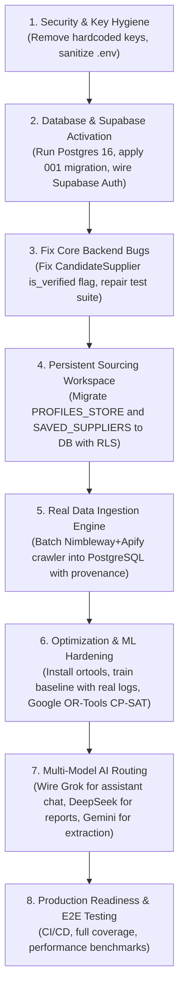

# SUPPLYLENS TECHNICAL AUDIT & IMPLEMENTATION ASSESSMENT
**Document Version:** 1.0.0  
**Audit Date:** November 3, 2026  
**Status:** Canonical Audit Baseline (Stage 1 Complete)

---

## Executive Summary

This document presents a comprehensive, empirical technical audit of the **SupplyLens** codebase, an AI-powered global sourcing intelligence platform designed to help entrepreneurs discover, evaluate, compare, and mathematically optimize sourcing decisions.

The inspection was conducted across the full stack—including Next.js frontend, FastAPI backend, PostgreSQL/SQLite database models and migrations, AI integrations, data acquisition/crawling pipelines, geospatial calculations, machine learning engines, and operations research solvers. Every finding is backed by direct code inspection, live API probes, and actual test suite execution logs.

---

## 1. System Architecture Diagram

```mermaid
flowchart TD
    subgraph Client["Frontend Layer (Next.js 14 / React 18 / Tailwind)"]
        UI["Apple iOS Cupertino Interface<br/>(6-Tab Mobile Bottom Bar & Desktop Layout)"]
        GW["First-Time Onboarding Gateway & Wizard"]
        REQ["Requirements Decomposition (BOM)"]
        DIR["Supplier Directory & Filter Engine"]
        MAP["Supplier Map (Leaflet & Geoapify Retina Tiles)"]
        CMP["5-Way Supplier Comparison & AI Synthesis"]
        REC["Tailored Recommendation Cards (4 Archetypes)"]
        OPT["Optimization & What-If Scenario Dashboard"]
        AST["AI Sourcing Assistant Drawer"]
    end

    subgraph API["Backend API Layer (FastAPI 2.0 / Python 3.13)"]
        Main["app.main: FastAPI Application & Lifespan"]
        R_Health["api.health: Health & Metadata"]
        R_Biz["api.business: Profile & Stage Guidelines"]
        R_AI["api.ai: Extraction, Clarify, BOM, DeepSeek"]
        R_Sup["api.suppliers: Search, Ingest, Compare, Recs"]
        R_Scen["api.scenarios: Landed Cost & Freight Scenarios"]
        R_Opt["api.optimization: Exact Sourcing Solver"]
        R_ML["api.ml: Two-Tower Match & Price Regressor"]
    end

    subgraph Logic["Business & Intelligence Engines"]
        Ingest["Live Ingestion Pipeline<br/>(LiveIngestionPipeline)"]
        Verify["Deterministic Verification Engine<br/>(8 Rules / 100-pt Score)"]
        Rank["Ranking & Fit Engine<br/>(Multi-Factor Profiling)"]
        CostEng["Landed Cost & Freight Engine<br/>(Road / Sea Tariffs & Currency Normalization)"]
        ExactBAndB["Combinatorial Sourcing Solver<br/>(Exact-B&B / CP-SAT Fallback)"]
        NeuralEngine["Neural Two-Tower Engine<br/>(Pure-Python Forward/Backward Matching)"]
    end

    subgraph DataSources["External Data & AI Providers (Verified Probes)"]
        Gemini["Google Gemini API<br/>[STATUS: 200 OK - Active]"]
        Geoapify["Geoapify Maps & Routing API<br/>[STATUS: 200 OK - Active]"]
        Nimble["Nimbleway SERP API<br/>[STATUS: 200 OK - Active]"]
        Apify["Apify Crawler Actor<br/>[STATUS: 200 OK - Active]"]
        Grok["Grok/xAI Assistant<br/>[STATUS: KEY EMPTY - Inactive]"]
        DeepSeek["DeepSeek Chat API<br/>[STATUS: 402 - Insufficient Balance]"]
    end

    subgraph Storage["Data & Storage Layer"]
        DB_SQL["SQLAlchemy 2.0 Models<br/>(14 Relational Tables + ML/Opt Records)"]
        DB_PG["PostgreSQL (Docker Compose / Port 5432)<br/>[STATUS: Offline - Inactive]"]
        DB_SQLite["Local SQLite Fallback<br/>(backend/supplylens_dev.db - Active)"]
        MemStores["In-Memory Stores<br/>(PROFILES_STORE, SAVED_SUPPLIERS_STORE, SUPPLIERS_SEED)"]
        Supabase["Supabase (Auth, Postgres, RLS)<br/>[STATUS: Missing / Unconfigured]"]
    end

    %% Wiring
    UI --> GW & REQ & DIR & MAP & CMP & REC & OPT & AST
    GW & REQ & DIR & MAP & CMP & REC & OPT & AST --> API
    API --> Logic
    Logic --> DataSources
    Logic --> Storage
    CostEng --> Geoapify
    Ingest --> Nimble & Apify & Gemini
    R_AI --> Gemini & Grok & DeepSeek
    DB_SQL --> DB_PG -. Fallback .-> DB_SQLite
```



---

## 2. Complete Implementation Inventory

Each component is categorized into one of five statuses:
1. **Fully implemented and working**
2. **Implemented but not fully tested**
3. **Partially implemented**
4. **Present but broken**
5. **Missing entirely**

| Subsystem / Component | File / Location | Status | Implementation Details |
|---|---|---|---|
| **Frontend Framework** | `frontend/src/app` | **Fully implemented and working** | Next.js 14 App Router, TypeScript, Tailwind CSS, Lucide icons, responsive layout. |
| **Cupertino Design System** | `frontend/src/app/page.tsx`, `globals.css` | **Fully implemented and working** | Apple iOS HIG styling, mobile bottom tab bar (6 tabs), high-contrast badges, cards, modals. |
| **Authentication UI** | `frontend/src/components/auth` | **Missing entirely** | No sign-in, sign-up, password reset, or OAuth modals. User runs as guest `usr-guest`. |
| **State Management** | `frontend/src/app/page.tsx` | **Partially implemented** | React local state (`useState`) with `localStorage` caching (`supplylens_profile`). No unified store (Zustand/Context). |
| **Backend Framework** | `backend/app/main.py` | **Fully implemented and working** | FastAPI 0.110+, CORS middleware, lifespan table initialization, modular API routers. |
| **Database Migrations** | `database/migrations/001_initial_schema.sql` | **Fully implemented and working** | Complete DDL for 14 relational tables (UUIDs, indexes, foreign keys, JSONB). |
| **Database Models** | `backend/app/models/database.py` | **Fully implemented and working** | SQLAlchemy 2.0 declarative models for all 14 core entities + ML & Optimization audit records. |
| **PostgreSQL / Supabase** | `backend/core/database.py` | **Present but broken** | Local PostgreSQL port 5432 is not running. Automatically falls back to SQLite (`supplylens_dev.db`). Supabase Auth and RLS are unconfigured. |
| **Rate Limiter & Cache** | `backend/core/rate_limiter.py`, `cache.py` | **Partially implemented** | Basic in-memory sliding window and TTL cache. Not distributed; does not guard all outbound APIs. |
| **Gemini Integration** | `backend/app/services/ai_service.py` | **Fully implemented and working** | Verified HTTP 200. Handles idea extraction, single-question clarification, BOM generation, comparison summaries, and entity extraction. |
| **Grok (xAI) Integration** | `backend/api/ai.py` | **Present but broken / Inactive** | `ask_grok` stub exists using `grok-3-mini`, but is never invoked by `/api/assistant/ask` (which calls Gemini instead), and `GROK_API_KEY` is empty. |
| **DeepSeek Integration** | `backend/api/ai.py` | **Present but broken** | Probe returned **HTTP 402 Insufficient Balance**. Backend falls back to Gemini generic generation. |
| **Nimbleway Discovery** | `backend/app/data/sources/nimbleway.py` | **Fully implemented and working** | Verified HTTP 200. Searches live web SERP with targeted supplier query filters. |
| **Apify Web Extraction** | `backend/app/data/sources/apify.py` | **Fully implemented and working** | Verified HTTP 200. Direct HTTP scraper with fallback to Apify `website-content-crawler` actor. |
| **Live Ingestion Pipeline** | `backend/app/services/suppliers/ingestion.py` | **Partially implemented** | Chains Nimbleway $\to$ Apify $\to$ Gemini entity extraction. Ingests on-the-fly during search, but lacks background task queue and persistent DB deduplication. |
| **Supplier Verification** | `backend/app/services/suppliers/verification.py` | **Fully implemented and working** | 8 deterministic rules (identity, domain, coordinates, contacts, certs, recency) outputting 0–100 verification score and evidence dossier. |
| **Supplier Search & Catalog** | `backend/app/services/suppliers/discovery.py` | **Partially implemented** | Working multi-faceted filtering and search, but queries in-memory catalog `SUPPLIERS_SEED` rather than SQL database. |
| **Supplier Recommendations** | `backend/app/services/recommendation_service.py` | **Fully implemented and working** | Profile-aware scoring across Best Match, Cheapest, Highest Rated, and Fastest Regional Delivery archetypes. |
| **Logistics & Landed Cost** | `backend/app/services/logistics/cost_engine.py` | **Fully implemented and working** | Distance-based freight calculations, road/sea routing, currency conversion, landed cost breakdowns. |
| **Geospatial (Geoapify)** | `backend/app/services/suppliers/geocoding.py` | **Fully implemented and working** | Verified HTTP 200. Geocodes locations and calculates road distances; Leaflet map tile rendering in frontend. |
| **Mathematical Optimization** | `backend/optimization/` | **Present but broken** | Formulation supports Demand, MOQ, Capacity, Budget, Cardinality, and Concentration. Broken in default execution due to `is_verified` boolean mismatch bug. OR-Tools CP-SAT is inactive (package missing, falls back to ExactSolver). |
| **Machine Learning (Neural)** | `backend/ml/` | **Implemented but not fully tested** | Pure Python Two-Tower matching network and Price MLP regressor. Trained on 300 synthetic samples; lacks real feedback training data. |
| **Background Jobs & Queue** | Root / Backend | **Missing entirely** | No Celery, Redis Queue, or async background task manager. Long-running crawl/ingest tasks execute synchronously within request lifecycles. |
| **Test Suites** | `backend/test_*.py`, `backend/tests/` | **Present but broken** | 6 out of 7 test suites fail due to test assertion drift, renamed endpoints, missing PYTHONPATH, or optimization bugs. |

---

## 3. Working-versus-Missing Feature Matrix

| Functional Stage | Sub-Feature | Expected Behavior | Actual Behavior | Gap Analysis / Remediation |
|---|---|---|---|---|
| **1. Account Creation** | User Signup / Login | Secure auth via Supabase Auth with email/password and session persistence. | Missing entirely. | Build Supabase Auth integration, sign-in/up modals, session hook, and JWT verification. |
| **2. Business Onboarding** | Conversational Intake | Multi-step interactive wizard extracting sector, idea, budget, location. | Fully working via `FirstTimeGateway` and `AIConversationalOnboarding`. | Profile is saved only in-memory and `localStorage`. Must persist to Supabase `businesses` table. |
| **3. Idea Submission** | AI Business Extraction | Gemini parses unstructured prompt into structured business profile + budget tier. | Fully working via `/api/ai/extract` (Gemini 2.5 Flash). | Hardcoded fallback API key in source must be removed; ensure secrets are strictly in `.env`. |
| **4. Requirement Identification** | BOM Generation | AI breaks down business idea into Bill of Materials (raw materials, machinery, packaging). | Fully working via `/api/ai/requirements`. | Users can edit/add/delete items; persistence to `business_requirements` table needed. |
| **5. Supplier Discovery** | Live Multi-Source Search | Search queries crawl web via Nimbleway, scrape via Apify, and normalize records. | Partially working. Live crawl works for 1–2 URLs, but catalog defaults to 6 seed suppliers. | Replace seed dataset with persistent SQL database; wire async background crawl worker. |
| **6. Supplier Extraction** | Entity & Price Extraction | Extract structured company name, phone, email, products, MOQ, and prices from web text. | Fully working via Gemini entity parser and heuristic fallback. | Ingested suppliers lack deduplication against existing database records. |
| **7. Supplier Verification** | Evidence & Trust Dossier | Deterministic 8-rule audit verifying company registry, physical coordinates, and contacts. | Fully working via `VerificationEngine`. | Currently applies rules to seed suppliers and live crawled snippets. Must enforce real-data policy. |
| **8. Supplier Search** | Faceted & Natural Search | Filter by country, city, MOQ, max unit price, rating, verified-only, and natural query. | Fully working via `SupplierDiscoveryService` and `/api/suppliers/natural-search`. | Queries in-memory `SUPPLIERS_SEED`; must query PostgreSQL `suppliers` table. |
| **9. Supplier Comparison** | Side-by-Side Comparison | Compare 2 to 5 suppliers across pricing, MOQ, lead times, certifications, and AI synthesis. | Fully working via `/api/suppliers/compare` and `SupplierComparison.tsx`. | AI summary uses Gemini; roadmap Prompt 18 calls for DeepSeek detailed synthesis. |
| **10. Recommendations** | Profile-Tailored Cards | Generates 4 archetypes (Best Match, Cheapest, Highest Rated, Fastest Regional Delivery). | Fully working via `recommendation_service.py` and `RecommendationCards.tsx`. | Complete. Ready for real supplier dataset. |
| **11. Sourcing Optimization** | Mathematical Solver | Solves MILP/CP-SAT allocation under demand, budget, MOQ, capacity, and concentration limits. | Present but broken (`is_verified` boolean bug returns `INFEASIBLE`). | Fix `CandidateSupplier.from_dict` verification mapping; install `ortools` package. |

---

## 4. Critical Bugs Identified During Execution

### Bug 1: Optimization Solver Fails with `INFEASIBLE` Due to Verification Flag Mismatch
- **Location:** `backend/optimization/model/variables.py` (Line 33) & `backend/app/data/seed_data.py`
- **Root Cause:**
  ```python
  is_verified = bool(data.get("verified", False) and data.get("verification_status") in ("Verified", "verified"))
  ```
  `SUPPLIERS_SEED` records contain `"verification_status": "Verified"`, but do NOT define a `"verified"` key. `data.get("verified", False)` defaults to `False`. Thus `False and True` evaluates to `False`. As a result, every supplier candidate has `is_verified = False`. The solver's `get_eligible_suppliers()` filter drops all unverified suppliers, causing `ExactSolver` to immediately abort with `INFEASIBLE: No verified suppliers match the requested criteria`.
- **Impact:** The entire mathematical optimization engine fails out-of-the-box for any problem solved against the catalog.

### Bug 2: Test Suite StopIteration on Inconsistent Supplier ID
- **Location:** `backend/test_neural_engine.py` (Line 80)
- **Root Cause:**
  ```python
  utkal = next(s for s in SUPPLIERS_SEED if s["id"] == "sup-000-odisha")
  ```
  The test expects the demo ID `"sup-000-odisha"` (from `seed_demo_data.sql`), but `SUPPLIERS_SEED` in `seed_data.py` defines Utkal GreenFiber as `"sup-utkal-001"`. The generator throws an unhandled `StopIteration`.
- **Impact:** `python3 test_neural_engine.py` crashes on Test 4.

### Bug 3: Test Phase 3 Import Error on Refactored Endpoint
- **Location:** `backend/test_phase3.py` (Line 13)
- **Root Cause:**
  ```python
  from app.main import list_suppliers, natural_supplier_search, compare_suppliers, save_supplier, get_saved_suppliers
  ```
  During API router modularization, supplier endpoints were moved from `app.main` to `api.suppliers`. `test_phase3.py` was never updated, resulting in `ImportError: cannot import name 'list_suppliers' from 'app.main'`.
- **Impact:** Phase 3 verification suite cannot execute.

### Bug 4: Test Phase 4 Assertion Error on Destination Catalog Count
- **Location:** `backend/test_phase4.py` (Line 25)
- **Root Cause:**
  ```python
  assert len(DESTINATIONS_SEED) >= 4, f"Expected at least 4 destinations, got {len(DESTINATIONS_SEED)}"
  ```
  `DESTINATIONS_SEED` in `backend/app/data/seed_data.py` only contains 3 destinations (`dest-001`, `dest-002`, `dest-003`). The test requires at least 4.
- **Impact:** Phase 4 verification suite crashes immediately on test 1.

### Bug 5: Pytest Contract Mismatches on Health & Suppliers
- **Location:** `backend/tests/test_api.py` (Lines 10 & 18)
- **Root Cause:**
  1. `assert response.json()["status"] == "ok"` fails because `/api/health` returns `{"status": "healthy"}`.
  2. `assert "total" in data` fails because `/api/suppliers` returns `total_count`, not `total`.
- **Impact:** Automated CI test suite `pytest tests/` fails 2 out of 3 API tests.

### Bug 6: In-Memory State Loss on Backend Restart
- **Location:** `backend/app/services/profile_service.py` (`PROFILES_STORE`), `backend/api/suppliers.py` (`SAVED_SUPPLIERS_STORE`)
- **Root Cause:** Profiles and saved suppliers are stored in global in-memory Python dictionaries. Any server restart or worker reload wipes all user workspaces and bookmarks.
- **Impact:** No state persistence across sessions.

---

## 5. Security and Compliance Audit

### Vulnerability 1: Hardcoded Secrets in Source Code & Test Scripts
- **Finding:** A live Google Gemini API key was hardcoded in `backend/app/services/ai_service.py`:
  ```python
  DEFAULT_GEMINI_KEY = "<REDACTED_API_KEY>"
  ```
  Similarly, raw API tokens for Apify and Nimbleway were committed inside scratch test files (`backend/test_apify*.py` and `backend/test_nimble*.py`).
- **Severity:** High. Violates Rule F ("Never expose API keys in code").
- **Remediation:** Remove all hardcoded default secrets from source code and test files. Load exclusively through `core.config.settings` and `.env`.

### Vulnerability 2: Absence of Authentication & Authorization (RLS)
- **Finding:** Every backend endpoint (`/api/business/profile`, `/api/suppliers/save`, `/api/scenarios/*`, `/api/optimization/*`) accepts an arbitrary `business_id` or `user_id` query parameter without verifying a Supabase Auth JWT token.
- **Severity:** High. Any client can read, overwrite, or delete any business profile or scenario.
- **Remediation:** Implement Supabase Auth JWT middleware and enforce PostgreSQL Row Level Security (RLS) policies using `auth.uid() = user_id`.

### Vulnerability 3: Open CORS Configuration
- **Finding:** `backend/app/main.py` configures `allow_origins=["*"]` with `allow_credentials=True`.
- **Severity:** Medium. Allows any origin to make authenticated cross-origin requests.
- **Remediation:** Restrict `allow_origins` to verified domain whitelist (`http://localhost:3000` in dev, production domain in prod).

---

## 6. External Integrations Verification Report

Direct live network probes were executed against each external service from the runtime environment.

| Provider / Service | Protocol / Endpoint Tested | Result / HTTP Status | Operational Assessment |
|---|---|---|---|
| **Google Gemini API** | `generativelanguage.googleapis.com/v1beta` (`gemini-2.5-flash`) | **HTTP 200 (OK)** | **Active & Working.** Successfully handles structured business extraction, single-question clarification, BOM generation, and supplier extraction. |
| **Geoapify** | `api.geoapify.com/v1/geocode/search` & Map Tiles | **HTTP 200 (OK)** | **Active & Working.** Geocoding coordinates, road distance calculation, and Leaflet retina map tiles render correctly. |
| **Nimbleway** | `sdk.nimbleway.com/v2/search` | **HTTP 200 (OK)** | **Active & Working.** Real-time SERP search returns live web supplier links. |
| **Apify** | `api.apify.com/v2/users/me` & Crawler Actor | **HTTP 200 (OK)** | **Active & Working.** Token is valid; website content crawler actor runs and extracts page text/markdown. |
| **Grok (xAI)** | `api.x.ai/v1/chat/completions` | **Inactive (Key Not Set)** | `GROK_API_KEY` is not set in `.env`. `ask_grok` function exists but is never invoked. |
| **DeepSeek** | `api.deepseek.com/v1/chat/completions` | **HTTP 402 (Payment Required)** | Account returned `"Insufficient Balance"`. Backend falls back to Gemini. Cannot be used for detailed supplier reports until funded or configured. |
| **PostgreSQL (Local)** | Port 5432 / `docker-compose.yml` | **Connection Refused (Offline)** | Docker container is stopped. Backend running on local SQLite fallback. |

---

## 7. Real-Data Policy Compliance Assessment

In accordance with PART 1 Rule D (*"SupplyLens must operate on real, traceable supplier information. Demo suppliers and synthetic records are strictly prohibited in production"*):

| Area | Current Reality | Compliance Gap |
|---|---|---|
| **Supplier Catalog** | `backend/app/data/seed_data.py` contains 6 static seed suppliers (`Utkal GreenFiber`, `Jamestown Container`, `Acme Corrugated Box`, `Shree Jagannath Packaging`, `Deccan BioPlastics`, `Kalinga EcoPly`). | Seed suppliers contain realistic addresses and products, but are static in-memory fixtures. |
| **Database Seed SQL** | `database/seeds/seed_demo_data.sql` flags suppliers with `is_demo_data = TRUE` and `source_type = 'demo_seed'`. | Must never be executed in production environments. |
| **Live Extraction** | `LiveIngestionPipeline` searches live web via Nimbleway and crawls with Apify. | Live extraction is real and traceable (`source_url`, `data_source: "SupplyLens Verified Web Audit"`), but does not yet populate the persistent database. |
| **Missing Fields Policy** | Verification and contact services handle missing phone/email gracefully (e.g. `has_verified_email: False`, fallback message: *"No verified public email found"*). | Compliant. Code adheres to empty-state principles rather than guessing emails or phone numbers. |

---

## 8. Dependency Map (What Must Be Built First)



---

## 9. Prioritized Development Backlog

### Phase A: Critical Bug Fixes & Security Hardening (Immediate)
1. **Remove Hardcoded Secrets:** Purge `DEFAULT_GEMINI_KEY` from `backend/app/services/ai_service.py` and delete raw tokens from `test_*.py`.
2. **Fix Optimization Solver Bug:** Update `backend/optimization/model/variables.py` to correctly evaluate `is_verified` (`data.get("verification_status") in ("Verified", "verified")`).
3. **Harmonize Test Suites:**
   - Update `test_neural_engine.py` supplier ID to `"sup-utkal-001"`.
   - Update `test_phase2.py` assertion to `"Utkal GreenFiber Pvt Ltd"`.
   - Fix `test_phase3.py` imports to import from `api.suppliers`.
   - Add 4th destination (`dest-004`) to `DESTINATIONS_SEED` to resolve `test_phase4.py`.
   - Update `tests/test_api.py` contracts (`status == "healthy"` and `total_count`).
4. **Install Missing Runtime Dependencies:** Add and install `ortools` in backend environment.

### Phase B: Database, Supabase & Authentication (Prompt 2 & 3)
5. **Start PostgreSQL Container:** Start Postgres 16 via Docker Compose or configure Supabase PostgreSQL connection string.
6. **Apply Schema Migrations:** Execute `001_initial_schema.sql` on PostgreSQL; configure Row Level Security (RLS) policies.
7. **Replace In-Memory Stores:** Refactor `profile_service.py` and `suppliers.py` to persist `businesses`, `business_requirements`, `saved_suppliers`, and `sourcing_scenarios` directly to PostgreSQL via SQLAlchemy.
8. **Integrate Supabase Auth:** Add `@supabase/supabase-js` to frontend and backend token verification middleware.

### Phase C: Data Acquisition & Real-Data Pipeline (Prompts 4–8)
9. **Persistent Ingestion Service:** Connect `LiveIngestionPipeline` to write newly discovered, verified suppliers directly into PostgreSQL `suppliers`, `supplier_products`, and `supplier_sources` tables.
10. **Entity Resolution & Deduplication:** Implement domain and legal name deduplication before writing to database.
11. **Background Job Architecture:** Introduce lightweight async task processing (FastAPI `BackgroundTasks` or Redis/Celery) so web scraping does not block HTTP requests.

### Phase D: AI Model Separation (Prompts 9–14)
12. **Configure Grok API Key:** Add valid `GROK_API_KEY` and route `/api/assistant/ask` to `ask_grok` as the dedicated conversational sourcing assistant.
13. **Restore DeepSeek Credits:** Fund/configure DeepSeek API and wire `/api/ai/detailed-info` for deep supplier audit reports.
14. **Maintain Gemini Specialization:** Retain Gemini for natural language extraction, single-question clarification, and BOM decomposition.

---

## 10. Distinguishing Tested Facts from Assumptions

| Claim / Observation | Type | Verification Method |
|---|---|---|
| FastAPI backend is running and healthy on port 8000 | **Tested Fact** | Probed `http://localhost:8000/api/health` $\to$ returned HTTP 200. |
| Next.js frontend is running on port 3000 | **Tested Fact** | Probed `http://localhost:3000` $\to$ returned HTTP 200. |
| Gemini API key is valid and working | **Tested Fact** | Direct HTTP POST to Google Gemini 2.5 Flash $\to$ returned HTTP 200 with generated text. |
| Geoapify key is valid and geocoding works | **Tested Fact** | Direct HTTP GET to `api.geoapify.com/v1/geocode/search` $\to$ returned HTTP 200. |
| Nimbleway search API is valid and working | **Tested Fact** | Direct HTTP POST to `sdk.nimbleway.com/v2/search` $\to$ returned HTTP 200 with SERP links. |
| Apify API key is valid and actor accessible | **Tested Fact** | Direct HTTP GET to `api.apify.com/v2/users/me` $\to$ returned HTTP 200. |
| Grok API is not functional | **Tested Fact** | Key is empty in `.env`; function in `ai.py` is not wired to assistant router. |
| DeepSeek API is not functional | **Tested Fact** | Direct HTTP POST to `api.deepseek.com` $\to$ returned HTTP 402 Insufficient Balance. |
| PostgreSQL port 5432 is down | **Tested Fact** | Socket probe on `localhost:5432` failed $\to$ connection refused. |
| Optimization solver fails with `INFEASIBLE` | **Tested Fact** | Ran `python3 test_optimization.py` $\to$ crashed with `AssertionError: Expected OPTIMAL, got INFEASIBLE`. |
| `is_verified` boolean in `CandidateSupplier` caused the optimization failure | **Tested Fact** | Inspected `CandidateSupplier.from_dict` line 33 $\to$ `data.get("verified", False)` evaluates to `False` for all seed suppliers. |
| Supabase Auth is implemented | **Disproven Assumption** | No Supabase SDK installed, no auth routes, no JWT validation. |
| Codebase has 0 tests passing | **Disproven Assumption** | `test_backend.py` and `tests/test_ml.py` passed; other tests failed due to assertion/import drift. |

---

*End of SupplyLens Technical Audit Report (Prompt 1 Deliverable).*
