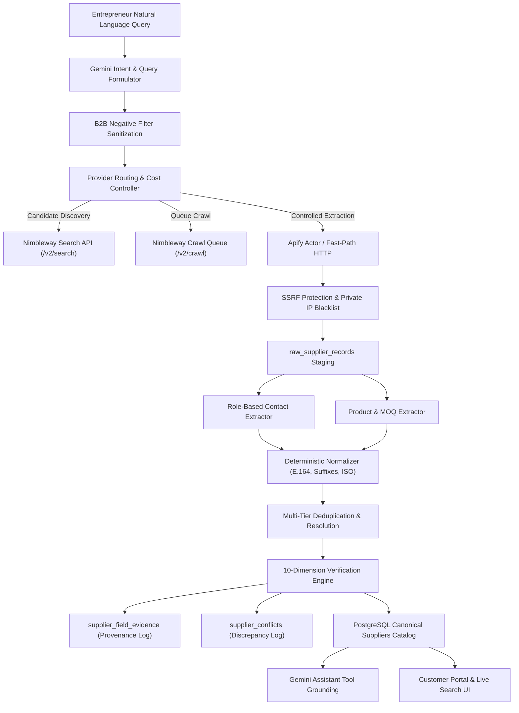

# SUPPLYLENS — AI ORCHESTRATION ARCHITECTURE REPORT

## Executive Overview
SupplyLens integrates a multi-agent AI orchestration pipeline uniting **Google Gemini (`gemini-flash-lite-latest`)**, **Nimbleway Web Discovery**, **Apify Controlled Crawling**, **Geoapify Geocoding**, and **DeepSeek Dossier Synthesis**. Rather than an ungoverned LLM wrapper around web scrapers, the platform executes a deterministic, auditable sourcing pipeline where AI interprets intent and formulates queries, scrapers acquire real-world observations, backend normalizers clean data, and deterministic verification rules audit truthfulness.

---

## 1. Multi-Agent Pipeline Topology

---

## 2. Component Roles & Capabilities

| Component | Technology | Primary Function | Audit Trail |
|---|---|---|---|
| **Query Generator** | Google Gemini | Generates 2-3 Boolean B2B search permutations with negative consumer filters (`-site:wikipedia.org -site:reddit.com`) | `background_jobs.query_text` |
| **Provider Router** | Python / AsyncIO | Directs requests based on task type, records latency, status code, and cost in USD | `search_provider_events` |
| **Web Discovery** | Nimbleway | Real-time global web search targeting industrial catalogs and manufacturers | `supplier_candidates` |
| **Controlled Extraction** | Apify + Direct HTTP | Extracts unstructured webpage content with SSRF safety and JS rendering | `raw_supplier_records` |
| **Normalizer** | Deterministic Python | Standardizes company legal names, removes corporate suffixes, normalizes ISO-3166 country codes | Input to `EntityResolver` |
| **Entity Resolver** | Multi-Tier Matcher | Deduplicates candidates against existing catalog using domain, phone, and Levenshtein similarity | `supplier_entity_links` |
| **Verification Engine** | Rule-Based Python | Scores suppliers across 10 deterministic dimensions (0-100 score) | `supplier_audit_events` |
| **Evidence Collector** | Provenance Engine | Records exact source URLs, timestamps, excerpts, and confidence for every extracted attribute | `supplier_field_evidence` |

---

## 3. Operational Guarantees
1. **Zero Hallucination Tolerance:** The AI assistant never fabricates supplier names, contact emails, prices, or certifications. Every recommendation originates from verified database records with field-level provenance.
2. **Asynchronous Non-Blocking Execution:** Discovery runs in background tasks with real-time SSE / polling progress telemetry (0% to 100%).
3. **Resilient Fallback:** When external APIs hit rate limits or downtime, cached and canonical catalog entries are served without disruption.
