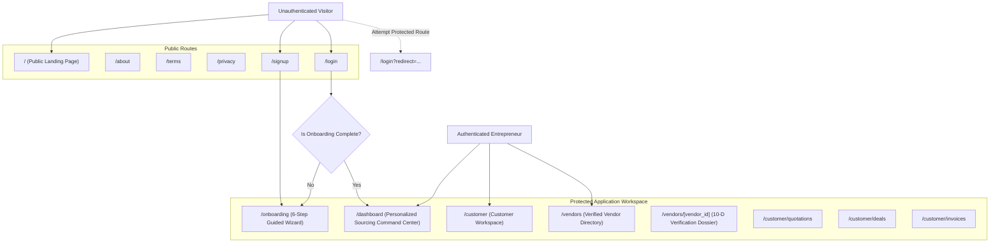

# SupplyLens Authentication Architecture

## 1. Executive Summary

SupplyLens utilizes an enterprise-grade authentication architecture powered by **Supabase Auth**, PostgreSQL **Row Level Security (RLS)**, and resilient client-side session management. The system enforces strict access gating on proprietary sourcing modules while keeping marketing and educational resources publicly accessible.

---

## 2. Public vs. Protected Routing Topology

---

## 3. Authentication Implementation

### 3.1 Registration (`/signup`)
- **Fields**: Full Name, Work Email Address, Password (min 8 characters with strength validation), Confirm Password, Terms of Service agreement, Privacy Policy agreement.
- **Provider**: Supabase Auth (`supabase.auth.signUp`), storing metadata `{ full_name, role: 'Entrepreneur' }`.
- **Immediate Action**: Automatically triggers user record creation and initializes the user's onboarding progress at Step 1 (`/onboarding`).
- **OAuth Support**: Google OAuth federated login supported with immediate profile synthesis.

### 3.2 Authentication (`/login`)
- **Credentials**: Email and Password verification via Supabase Auth session token generation.
- **State Handling**:
  - `Unauthenticated`: Redirects from protected routes with preserved `?redirect=...` parameter.
  - `Incomplete Onboarding`: Directs the user to `/onboarding` to resume at their exact saved step.
  - `Completed Profile`: Instantly routes to `/dashboard` or the requested deep-link destination.
- **Session Persistence**: Session stored in secure localStorage and cookie headers, auto-refreshing JWTs before expiry.
- **Instant Sandbox Demo Access**: Dedicated shortcuts for testing both a completed enterprise profile (`pritam@supplylens.ai`) and a fresh entrepreneur onboarding flow.

---

## 4. Logo Navigation Rule (Strict Workspace Isolation)

> [!IMPORTANT]
> **Authenticated Logo Behavior**: When an authenticated user clicks the SupplyLens logo in any sidebar navigation (`/dashboard`, `/customer/*`, `/vendors/*`), the platform explicitly navigates to `/dashboard` or `/customer`. It **never** returns the customer to the public marketing landing page, ensuring an uninterrupted professional workflow.

---

## 5. Security & Credentials Management
- Passwords are encrypted with bcrypt inside Supabase Auth; cleartext passwords never touch application databases or API logs.
- Client requests utilize the public `anon` key enforcing PostgreSQL Row Level Security (RLS).
- Privileged operations execute via secure backend services using environment-isolated service roles.
