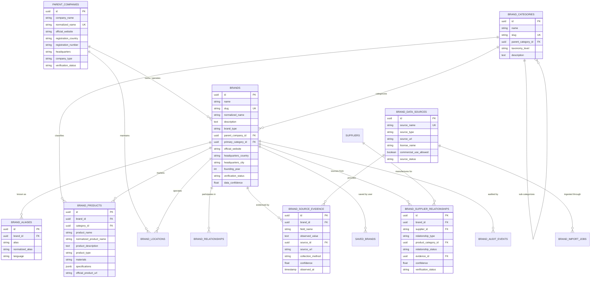

# SUPPLYLENS — GLOBAL BRAND INTELLIGENCE DATABASE ARCHITECTURE

**Product:** SupplyLens  
**Engineering Discipline:** Data Modeling, Database Architecture, Sourcing Intelligence  
**Version:** 1.0 (Production Release)  
**Status:** Canonical Reference Architecture  

---

## 1. Executive Vision & Core Principles

The **SupplyLens Global Brand Intelligence Database** provides a structured, evidence-backed knowledge graph of real-world commercial brands, their corporate ownership, product catalogs, geographical presence, and documented manufacturing and supplier relationships.

### Core Architectural Axioms:
1. **Separation of Legal Identity from Brand Identity:** A brand (e.g. *Patagonia*, *Apple*, *IKEA*) is distinct from its parent legal entity (e.g. *Patagonia Works*, *Apple Inc.*, *Ingka Holding B.V.*).
2. **Separation of Headquarters from Manufacturing Facilities:** A corporate headquarters in Cupertino, California or Ventura, California must never be recorded as a manufacturing facility.
3. **No Unsubstantiated Inferences:** Never assume that a supplier manufactures for a brand merely because they operate in the same industry or geographic region. Every relationship must cite verified source evidence.
4. **Traceable Multi-Layer Evidence:** Every brand attribute and supplier link is supported by a cryptographic audit trail referencing the observed source, retrieval timestamp, extraction method, and validation status.

---

## 2. Entity-Relationship Model (Mermaid Diagram)



---

## 3. Detailed Entity Definitions

### 3.1 `brands` (Canonical Brand Table)
- `id`: UUID primary key.
- `name`: Official commercial brand name (e.g., "Patagonia", "Apple", "BoAt").
- `slug`: URL-friendly identifier (e.g., `patagonia`, `boat-lifestyle`).
- `normalized_name`: Uppercase alphanumeric string for fast duplicate matching.
- `description`: Verifiable company description.
- `brand_type`: Reference values (`brand_owner`, `consumer_brand`, `private_label`, `oem_brand`, `distributor_brand`, `industrial_brand`).
- `parent_company_id`: Foreign key to `parent_companies(id)`, nullable for independent brands.
- `primary_category_id`: Foreign key to `brand_categories(id)`.
- `official_website`: Validated HTTPS domain.
- `headquarters_country` & `headquarters_city`: Primary legal jurisdiction.
- `founding_year`: Verified inception year.
- `verification_status`: Controlled state (`verified`, `partially_verified`, `unverified`).
- `data_confidence`: Score between 0.00 and 1.00.

### 3.2 `parent_companies` (Legal Entities)
- `id`: UUID primary key.
- `company_name`: Official registered corporate name (e.g., "Apple Inc.", "Patagonia Works").
- `normalized_name`: Unique normalized corporate index.
- `registration_country`: ISO 3166-1 alpha-2 or country name.
- `registration_number`: Verified corporate registry identifier (e.g., CIK, CIN, LEI).
- `company_type`: Controlled values (`public_corporation`, `private_limited`, `holding_company`, `cooperative`).

### 3.3 `brand_supplier_relationships` (Supply Chain Edge Table)
The cornerstone linking brands to manufacturers in SupplyLens:
- `id`: UUID primary key.
- `brand_id`: Foreign key to `brands(id)`.
- `supplier_id`: Foreign key to SupplyLens `suppliers(id)`.
- `relationship_type`: Controlled values:
  - `contract_manufacturer` (Produces finished goods to brand specifications).
  - `oem_partner` (Original equipment manufacturing partner).
  - `tier_1_component_supplier` (Supplies critical sub-assemblies).
  - `raw_material_provider` (Supplies textiles, resins, alloys).
  - `sustainable_packaging_partner` (Supplies verified outer packaging).
- `relationship_status`: `active`, `historical`, `under_review`.
- `evidence_id`: Foreign key to `brand_source_evidence(id)` proving the relationship.
- `confidence`: Calibrated score (0.00 - 1.00) based on source authority.
- `verification_status`: `verified`, `pending_audit`, `disputed`.

### 3.4 `brand_source_evidence` (Audit Trail)
- `id`: UUID primary key.
- `brand_id`: Related brand.
- `field_name`: Specific fact supported (e.g., `supplier_relationship`, `headquarters`, `parent_company`).
- `observed_value`: Exact quote or structured assertion extracted from the source.
- `source_id`: Foreign key to approved `brand_data_sources`.
- `source_url`: Verifiable URL of regulatory filing, public disclosure, or Open Supply Hub record.
- `collection_method`: `automated_import`, `manual_audit`, `regulatory_filing`.
- `observed_at`: Ingestion timestamp.

---

## 4. Ingestion & Normalization Pipeline

```
[Approved Data Source]
       │
       ▼
1. Raw Source Record Ingestion
       │
       ▼
2. Alphanumeric Name Normalization (Strip punctuation, suffixes like Ltd/Inc/GmbH)
       │
       ▼
3. Deduplication Check against `brands.normalized_name` & `brand_aliases`
       │
       ├── Match Found ──► Link alias / record update audit event
       │
       └── No Match ──► Proceed to Canonical Entity Creation
                               │
                               ▼
4. Parent Company Resolution (Map parent holding entities)
                               │
                               ▼
5. Controlled Category & Taxonomy Mapping
                               │
                               ▼
6. Product Catalog Extraction & Material Profiling
                               │
                               ▼
7. Documented Supplier Relationship Resolution (Open Supply Hub / Public Disclosures)
                               │
                               ▼
8. Cryptographic Evidence Record Insertion (`brand_source_evidence`)
                               │
                               ▼
9. Canonical Database Insertion (`brands`, `brand_products`, `brand_supplier_relationships`)
```

---

## 5. Natural-Language Search & Intent Resolution

When an entrepreneur searches:
> *"Show me sustainable packaging brands in India and their verified contract manufacturers"*

1. **Gemini Intent Extraction:** Parses prompt into structured parameters:
   - `industry`: "Packaging"
   - `category`: "Sustainable Packaging"
   - `country`: "India"
   - `include_suppliers`: true
2. **Canonical Query Execution:** Executes an indexed SQL query joining `brands`, `brand_categories`, `brand_supplier_relationships`, and `suppliers`.
3. **Evidence Ranking:** Displays verified brands with their parent companies, product materials, and verifiable manufacturing facilities.
