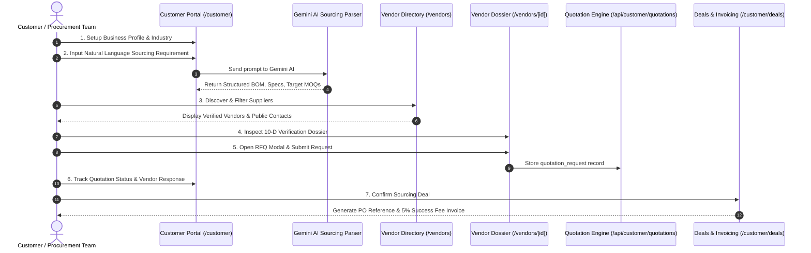

# Customer Sourcing Workflow & Vendor Interaction Model

## Executive Summary

SupplyLens bridges early-stage entrepreneurs and enterprise procurement teams with verified global manufacturers and raw-material suppliers. The customer sourcing workflow and vendor interaction model are structured into an interconnected lifecycle: from natural language sourcing requirement definition to vendor discovery, transparent 10-dimensional verification review, direct RFQ quotation requests, and closed-loop commercial deal management with automated 5% success fee invoicing.

---

## Architecture of the Interaction Model

---

## Phase-by-Phase Workflow Specification

### Phase 1: Registration & Business Profile Configuration
- **Route**: `/customer/profile` and `/customer/business`
- **Actions**:
  1. The user authenticates through Supabase Auth (or continues in Demo Sandbox mode).
  2. The customer provides business metadata: Legal Name, Industry, Operating Country/City, Target Markets, Stage (Idea, Seed, Growth, Scale), Operating Currency (`USD`, `EUR`, `INR`, `GBP`), and Core Sourcing Priorities (Cost, Speed, Quality, Low MOQ, Sustainability).
  3. The profile synchronizes with `business_profiles` in PostgreSQL, establishing context for AI-guided sourcing compatibility scoring.

### Phase 2: Sourcing Requirements Decomposition
- **Route**: `/customer/requirements`
- **Actions**:
  1. **Natural Language Input**: The customer articulates their product requirements in plain language (e.g., *"We are launching an eco-friendly cold brew coffee brand in glass bottles with kraft secondary packaging and bamboo caps"*).
  2. **Gemini AI Parsing**: The prompt is processed by the AI sourcing interpretation engine (`/api/customer/requirements/interpret`), decomposing the request into structured BOM line items:
     - Component Category (e.g., Primary Packaging, Closures, Secondary Packaging)
     - Target Material (e.g., Borosilicate Glass, Bamboo, Recycled Corrugated Board)
     - Estimated Volume & Target MOQ
     - Critical Technical Specifications (food-grade, airtight seals, UV resistance)
  3. **Direct Pipeline Link**: Each parsed BOM item features a single-click action: **"Find Matching Vendors"**, which pre-filters the Vendor Directory by material and category.

### Phase 3: Vendor Discovery & Multi-Faceted Exploration
- **Route**: `/vendors`
- **Capabilities**:
  1. **Omni-Search Bar**: Real-time searching across vendor trade name, legal entity name, primary materials, manufacturing capabilities, and location.
  2. **Granular Multi-Select Filters**:
     - **Country & Region**: India (Odisha, Gujarat, Maharashtra), United States (CA, TX, NY), Vietnam, Germany.
     - **Vendor Type**: Manufacturer, Raw Material Provider, Contract Fabricator, Packaging Specialist.
     - **Product Category**: Sustainable Packaging, Textiles & Apparel, Precision Electronics, Biomaterials.
     - **Certifications**: ISO 9001, FSC Certified, OEKO-TEX Standard 100, GOTS, FDA Registered.
     - **Verification Gate**: Toggle between All Vendors and Verified Only.
  3. **Truth in Data Policy**:
     - No synthetic prices or fabricated data.
     - Publicly listed catalog prices are clearly labelled, while custom configurations explicitly show *"Quote on Request"*.
     - Verified contact details reflect real domain emails and business premises.
  4. **Direct Interactivity**:
     - **Save Vendor**: Bookmarks supplier to `/customer/saved-vendors` for persistent tracking.
     - **Compare Vendor**: Adds supplier to side-by-side comparison matrix (up to 5 vendors).
     - **Request Quotation**: Spawns the unified RFQ modal.
     - **Card Click**: Direct navigation to `/vendors/[vendor_id]`.

### Phase 4: In-Depth Vendor Evaluation (10-D Verification Dossier)
- **Route**: `/vendors/[vendor_id]`
- **Dossier Structure**:
  1. **Overview & Header**: Badges, verification pill (`Demo Verified` / `Verified`), verification confidence score (e.g., 94%), operational headquarter coordinates, operational timeline.
  2. **About this Vendor**: Company origin, capabilities synopsis, production philosophies, export markets.
  3. **Products & Materials Catalog**: Line items detailing unit price ranges, batch capacity, lead times, and technical specs.
  4. **Pricing & MOQ Transparency Matrix**: Tabulated commercial terms with explicit tier breakdowns.
  5. **Location & Facilities**: Physical factory addresses, coordinates, surface area, and facility photographs.
  6. **Verified Public Contacts**: Verified phone numbers, verified corporate email addresses, official websites, and contact roles.
  7. **10-Dimensional Verification Evidence Engine**:
     - D1: Corporate Legal Registration & Registry Verification
     - D2: Physical Facility & Factory Presence
     - D3: Operational Domain & Email Verification
     - D4: Quality & Compliance Certifications
     - D5: Financial Standing & Solvency Indicator
     - D6: Manufacturing Equipment & Machine Capability
     - D7: ESG & Environmental Compliance
     - D8: Export Track Record & Customs Documentation
     - D9: Customer References & Verified Trade History
     - D10: Supply Chain Disruption Risk Assessment
  8. **AI Sourcing Intelligence & Business Fit**: Calculated compatibility score (0–100%) evaluating alignment between customer business profile priorities and vendor capabilities.

### Phase 5: Request for Quotation (RFQ) Submission
- **Component**: `RequestQuotationModal`
- **Fields**:
  - Target Product / Material selection from supplier catalog
  - Quantity requested & Unit of Measure (units, meters, kg, tons)
  - Target Delivery Date
  - Incoterms / Delivery Terms (`FOB`, `CIF`, `EXW`, `DDP`)
  - Target Shipping Destination (City, Country)
  - Detailed Specifications & Special Notes
- **Processing**:
  - Saved immediately to `quotation_requests` table with status `Draft` or `Submitted`.
  - Customer activity audit log automatically records an event: `Quotation Requested from [Vendor Name]`.
  - Quotation appears in `/customer/quotations` with status monitoring.

### Phase 6: Quotation Review & Negotiation
- **Route**: `/customer/quotations`
- **Features**:
  - Real-time tracking of request status (`Submitted`, `In Review`, `Quoted`, `Accepted`, `Declined`).
  - Detailed breakdown of supplier quotation response: Quoted Unit Price, Total Estimated Value, Quoted Lead Time, Payment Terms, and Supplier Operational Notes.
  - Action buttons: Accept Quote, Request Revision, Decline.

### Phase 7: Commercial Sourcing Deal Confirmation
- **Route**: `/customer/deals`
- **Features**:
  - Once a quotation is accepted, a formal commercial sourcing deal is instantiated.
  - Tracks Purchase Order (PO) reference, contract dates, delivery milestones, and final transaction volume.
  - Transparent calculation of SupplyLens **5% Platform Success Sourcing Fee** (e.g., on a \$12,500 PO, fee is \$625.00).

### Phase 8: In-Dashboard 5% Fee Invoicing & Settlement
- **Route**: `/customer/invoices`
- **Features**:
  - Generates downloadable commercial invoices corresponding to confirmed deals.
  - Clear line-item breakdown: Supplier PO total, 5% Platform Sourcing Fee, Sales Tax / GST, Total Payable.
  - In-dashboard instant checkout modal with simulated payment processing (Stripe / Razorpay card/net banking), updating invoice status to `Paid` immediately.

---

## Data Model & RLS Boundaries

| Table Name | Purpose | RLS Policy |
| :--- | :--- | :--- |
| `suppliers` | Canonical supplier & vendor registry | Public read for active; authenticated admin write |
| `supplier_products` | Raw materials and product SKUs | Public read for active; supplier owner write |
| `business_profiles` | Customer business and stage details | User isolated: `auth.uid() = user_id` |
| `quotation_requests` | RFQ submissions and supplier responses | Bidirectional isolation: `auth.uid() = customer_id` or vendor admin |
| `customer_activities` | Audit trail of customer interactions | User isolated: `auth.uid() = customer_id` |
| `vendor_profile_interactions` | Metrics on views, saves, and RFQs | Customer isolated; aggregated for vendor analytics |
| `deals` | Confirmed commercial sourcing orders | User isolated: `auth.uid() = customer_id` |
| `invoices` | 5% fee billing records and receipts | User isolated: `auth.uid() = customer_id` |

---

## Summary of Interaction Touchpoints

1. **Self-Service**: Complete independence for customers to search, filter, compare, and request quotations without mandatory platform sales calls.
2. **Transparent Integrity**: 100% adherence to verified evidence; missing data is acknowledged honestly rather than masked with AI illusions.
3. **Continuous Engagement**: Activities stream keeps procurement teams informed on quotes, saves, updates, and invoice settlements.
