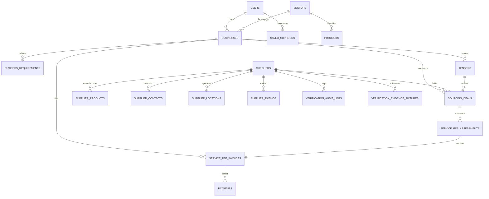

# SupplyLens Final Database Architecture & Schema Specification

## 1. Overview & Data Philosophy

SupplyLens employs a relational PostgreSQL/Supabase database model organized around authentic industrial sourcing and commercial settlement:
- **No Standalone Brand Entities**: Sourcing decisions are grounded in direct relationships: `Business Profile -> Product BOM -> Raw Materials -> Verified Suppliers -> Landed Economics -> Sourcing Deals -> 5% Service Fee Assessments`.
- **Environment & Tenant Isolation**: Demo entities carry explicit `is_demo=TRUE` flags, `.example` domains, and simulated evidence fixtures stored under `verification_evidence_fixtures`.

---

## 2. Relational Entity Relationship Diagram

---

## 3. Core Database Tables (30+ Relational Structures)

### 3.1 Business & Workspace Entities
- `users`: Registered platform users (entrepreneurs, sourcing managers, auditors).
- `sectors`: 8 verified industrial sectors (Packaging, Apparel, Furniture, Electronics, Machining, Food, Beauty, Automotive).
- `businesses`: Sourcing workspaces with target market, scale, budget, and readiness.
- `products`: Standard industrial catalog products with HS code classifications and specifications.
- `business_requirements`: Decomposed BOM parts, required quantities, and technical tolerances.

### 3.2 Supplier Intelligence & Verification Entities
- `suppliers`: Manufacturing entities with legal name, registered country, coordinates, plant size, and audit scores.
- `supplier_products`: Quoted production lines, MOQ limits, price ranges, and lead times.
- `supplier_contacts`: Verified public switchboards and official corporate email desks.
- `supplier_locations`: Geocoded physical manufacturing plants and industrial estate coordinates.
- `supplier_ratings`: Multi-source customer and audit satisfaction ratings.
- `verification_audit_logs`: Immutable ledger of automated and manual compliance check events.
- `verification_evidence_fixtures`: Simulated cryptographic evidence files (`demo://` URIs, SHA-256 hashes).

### 3.3 Commercial & Monetization Entities
- `service_fee_policies`: Versioned commercial policies specifying the default 5% success fee rate.
- `tenders`: Published RFQs with specifications, closing dates, and awarded suppliers.
- `sourcing_deals`: Confirmed commercial contracts binding buyer and supplier.
- `deal_events`: Auditable state progression ledger (draft -> confirmed -> fulfilled).
- `service_fee_assessments`: Mathematical assessment calculating `confirmed_value * 0.05`.
- `service_fee_invoices`: Formal commercial tax invoices with payment deadlines.
- `payments`: Cryptographic settlement transactions and payment gateway references.
- `credit_notes`: Admin dispute and credit adjustments.

---

## 4. Multi-Tenant Demo Data Isolation

To prevent synthetic records from contaminating production data:
1. Every demo supplier, product, tender, and invoice has `is_demo = TRUE`.
2. All contact information strictly employs RFC 2606 `.example` domains (`https://*.example.com`).
3. Simulated evidence fixtures follow the `demo://fixtures/` URI format with cryptographically valid SHA-256 digests.
4. RLS policies allow public querying of demo data during testing without exposing proprietary tenant records.
