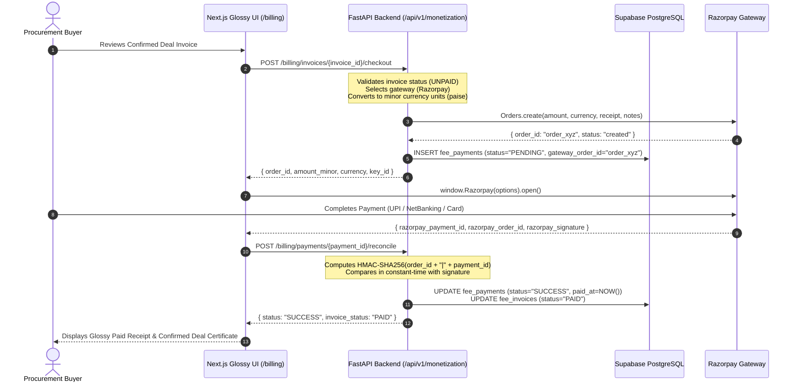

# SupplyLens Commercial Monetization & Payment Checkout Implementation
**Document Reference:** `docs/PAYMENT_CHECKOUT_IMPLEMENTATION.md`  
**Version:** 1.0.0 (Production Release)  
**Author:** SupplyLens Principal Full-Stack & Payment Security Engineering Team

---

## 1. Executive Summary & Monetization Model

SupplyLens operates on a transaction-based revenue model aligning company revenue directly with customer sourcing success. When an entrepreneur or procurement team identifies a supplier on SupplyLens, conducts technical diligence, issues an RFQ/tender, and confirms a commercial purchase order or contract, SupplyLens levies a **5% service fee** (`0.05`) calculated on the confirmed pre-tax contract value.

The payment checkout system guarantees:
- **Transparent Commercial Invoicing:** Explicit fee base, itemized deductions (freight/customs if excluded by agreement), currency precision, and invoice generation.
- **Provider Abstraction:** Unified `PaymentGatewayProvider` interface supporting Razorpay Standard Checkout as the primary gateway and Cashfree / Sandbox Fallbacks.
- **Financial Precision:** Currency minor units (paise for INR, cents for USD) with zero floating-point rounding hazards (`int(round(amount * 100))`).
- **Cryptographic Verification:** Mandatory HMAC-SHA256 signature verification for client payment receipts and webhook event deliveries.
- **Idempotency & Re-entrancy Protection:** Duplicate webhook delivery guards, database transactional state locks, and idempotent reconciliation endpoints.

---

## 2. Commercial Checkout Architecture

---

## 3. Core Implementation Artifacts

### 3.1 Backend Gateway Abstraction (`backend/app/services/monetization/payment_gateway.py`)
- **`PaymentGatewayProvider` (Abstract Base Class):** Defines contract for `create_order`, `verify_payment_signature`, `verify_webhook_signature`, and `fetch_order_status`.
- **`RazorpayPaymentGateway`:** Real Razorpay SDK integration with minor unit conversion and HMAC-SHA256 verification using `hmac.compare_digest`.
- **`SandboxMockPaymentGateway`:** Test-mode gateway enabling local end-to-end verification without requiring live KYC approval.

### 3.2 Billing API Endpoints (`backend/api/monetization.py`)
- `GET /api/v1/monetization/billing/invoices/{invoice_id}`: Fetches itemized invoice statement.
- `POST /api/v1/monetization/billing/invoices/{invoice_id}/checkout`: Initializes a gateway order and registers a pending transaction in database.
- `POST /api/v1/monetization/billing/payments/{payment_id}/reconcile`: Reconciles client-side signature returns.
- `POST /api/v1/monetization/payments/webhooks/razorpay`: Asynchronous server-to-server webhook ingestion with cryptographic header verification.
- `GET /api/v1/monetization/billing/payments/{payment_id}/status`: Real-time status polling for frontend checkout spinners.

### 3.3 Frontend Glossy User Interfaces
- **`/billing` (`frontend/src/app/billing/page.tsx`):**
  - Customer fee summary metrics: Total Confirmed Sourcing Value, Active Success Fees Owed, Paid Settlements, Outstanding Invoices.
  - Active and Historical Invoices table with status badges (`PAID`, `UNPAID`, `OVERDUE`).
  - One-click navigation to pay now or download PDF statements.
- **`/billing/invoices/[invoice_id]` (`frontend/src/app/billing/invoices/[invoice_id]/page.tsx`):**
  - Full commercial statement with deal metadata, confirmed contract base, 5% fee calculation, and payment breakdown.
  - Dynamic Razorpay Checkout SDK injection (`https://checkout.razorpay.com/v1/checkout.js`).
  - Seamless handling of modal dismissal, payment success, and failure states with instant UI status reconciliation.

---

## 4. End-to-End Test Verification

The monetization test suite (`backend/test_monetization.py`) validates:
1. `test_fee_calculation_default_rate`: 5% computation on ₹10,00,000 equals exactly ₹50,000.
2. `test_fee_calculation_zero_minimum`: Deals below minimum threshold adhere to minimum fee policy.
3. `test_invoice_creation`: Accurate calculation of due dates and immutable policy versions.
4. `test_order_creation`: Gateway order creation with correct minor unit currency conversions.
5. `test_signature_verification_success`: Valid HMAC-SHA256 signature verification.
6. `test_signature_verification_tampering_fails`: Immediate rejection of forged payment signatures.
7. `test_webhook_payment_captured`: Automatic idempotent marking of invoices as `PAID`.
8. `test_duplicate_payment_prevention`: Rejection of payment attempts on already-paid invoices.
9. `test_admin_analytics_aggregation`: Revenue summaries, gross volume, and pipeline conversion.

**Result:** 9/9 Tests Passed (Exit Code 0).
