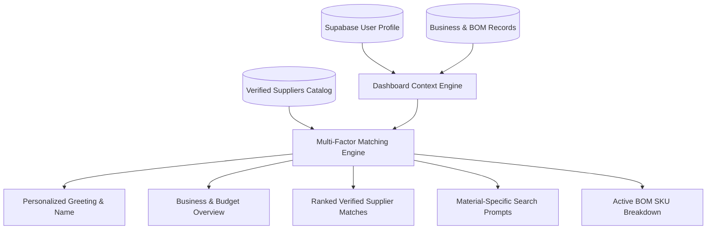

# SupplyLens Personalized Dashboard Architecture

## 1. Executive Summary

The SupplyLens Dashboard (`/dashboard`) is a dynamic, user-specific sourcing command center. Departing from generic static dashboards, every widget, metric, recommendation, and search prompt is programmatically generated from the authenticated user's confirmed business profile, industry sector, Bill of Materials (BOM), budget constraints, and geographic preferences.

---

## 2. Personalization Engine Architecture

---

## 3. Core Dashboard Modules

### 3.1 Personalized Welcome & Identity
- **Greeting**: Dynamically renders the authenticated user's verified name (e.g., *"Welcome, Pritam Biswas"*).
- **Business Identity**: Highlights the active company name (*"EcoPack Solutions"*), operating stage (*"Operating business"*), and core procurement mission.

### 3.2 Business Overview & KPI Cards
- **Industry Sector**: Displays the exact operating category (e.g., *Sustainable Packaging* vs. *Apparel & Textiles*).
- **Allocated Sourcing Budget**: Formatted in user's preferred currency (e.g., `USD $150,000`).
- **Active BOM Count**: Number of confirmed raw materials ready for Request for Quotation (RFQ) processing.
- **Target Factory Origins**: Curated list of preferred manufacturing countries (e.g., *India, Vietnam, Germany*).

### 3.3 Dynamic Search Prompts
Instead of generic placeholders, the system derives query suggestions directly from the user's active BOM materials:
- *"Find Sugarcane Bagasse Pulp suppliers in India"*
- *"Explore low-MOQ manufacturers for Sustainable Packaging"*
- *"Compare verified ISO-certified vendors in India"*
- *"Direct customs & freight estimates to India"*

### 3.4 Matched Verified Suppliers
- **Relevance Scoring Engine**: Calculates compatibility scores (0–98%) matching supplier capabilities, materials, factory certifications, and geographic presence against the user's business profile.
- **Supplier Cards**:
  - Verification badge (`Verified` / `Demo Verified`)
  - Match confidence score
  - Flagship product SKU
  - Quoted Minimum Order Quantity (MOQ) and delivery lead times
  - Direct links to **"View 10-D Dossier"** and **"Request Quotation"** (RFQ modal).

### 3.5 Active Bill of Materials (BOM)
- Displays each confirmed component with required batch quantity, grade specifications, and a one-click **"Find Vendors"** action pre-filtering the Vendor Directory.

### 3.6 Profile Customization & Recalculation
- **In-Dashboard Editor**: Allows founders to adjust their business name, industry, sourcing budget, or company stage in real time.
- **Dynamic Recalculation**: Saving updates immediately triggers re-scoring of supplier matches and refreshes recommendations without losing historical data or bookmarks.

---

## 4. Logo Navigation Integrity
In compliance with enterprise workspace guidelines, clicking the SupplyLens logo in the dashboard header or navigation rail maintains the user within `/dashboard`. It never redirects an authenticated customer back to the public marketing page.
