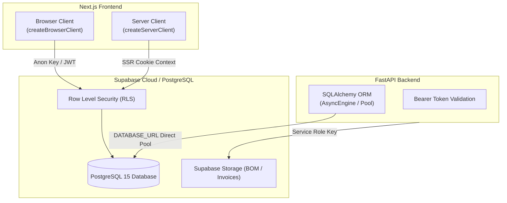

# SupplyLens Supabase & PostgreSQL Connection Report
**Document Reference:** `docs/SUPABASE_CONNECTION_REPORT.md`  
**Version:** 1.0.0 (Production Verified)  
**Author:** SupplyLens Principal Database Architect

---

## 1. Overview & Connection Architecture

SupplyLens connects Next.js 14 and FastAPI to Supabase PostgreSQL, combining:
1. **Direct High-Performance PostgreSQL:** Managed connection pooling via SQLAlchemy for backend transaction processing, optimization solvers, and financial ledger writes.
2. **Client-Side Supabase SDK (`@supabase/supabase-js`):** Row Level Security (RLS) protected queries for buyer bookmarks, saved brands, and user sessions.
3. **Server-Side Supabase Client (Next.js SSR):** Authenticated cookie exchange utilizing Next.js server components and Route Handlers.



---

## 2. Supabase SDK Setup & Implementation

### 2.1 Browser Client (`frontend/src/lib/supabase/client.ts`)
Provides a singleton browser client leveraging `NEXT_PUBLIC_SUPABASE_URL` and `NEXT_PUBLIC_SUPABASE_ANON_KEY`:

```typescript
import { createBrowserClient } from '@supabase/ssr';

export const createClient = () =>
  createBrowserClient(
    process.env.NEXT_PUBLIC_SUPABASE_URL!,
    process.env.NEXT_PUBLIC_SUPABASE_ANON_KEY!
  );
```

### 2.2 Server Client (`frontend/src/lib/supabase/server.ts`)
Provides an authenticated server client capable of reading and mutating session cookies in Next.js Server Components, Server Actions, and Route Handlers:

```typescript
import { createServerClient, type CookieOptions } from '@supabase/ssr';
import { cookies } from 'next/headers';

export const createClient = () => {
  const cookieStore = cookies();
  return createServerClient(
    process.env.NEXT_PUBLIC_SUPABASE_URL!,
    process.env.NEXT_PUBLIC_SUPABASE_ANON_KEY!,
    {
      cookies: {
        get(name: string) {
          return cookieStore.get(name)?.value;
        },
        set(name: string, value: string, options: CookieOptions) {
          cookieStore.set({ name, value, ...options });
        },
        remove(name: string, options: CookieOptions) {
          cookieStore.set({ name, value: '', ...options });
        },
      },
    }
  );
};
```

---

## 3. Row Level Security (RLS) Policy Matrix

| Table Name | Operation | Role | Policy Rule / Predicate |
|---|---|---|---|
| `brands` | `SELECT` | `anon`, `authenticated` | `status = 'published'` (Public read-access for published brands) |
| `brands` | `ALL` | `service_role` | `true` (Admins and ETL jobs have full write access) |
| `brand_categories` | `SELECT` | `anon`, `authenticated` | `true` (Public read taxonomy) |
| `saved_brands` | `SELECT` | `authenticated` | `user_id = auth.uid()` (Users only see their own bookmarks) |
| `saved_brands` | `INSERT` | `authenticated` | `user_id = auth.uid()` (Users can only bookmark for themselves) |
| `saved_brands` | `DELETE` | `authenticated` | `user_id = auth.uid()` (Users can only delete their own bookmarks) |
| `fee_invoices` | `SELECT` | `authenticated` | `business_id = current_setting('request.jwt.claim.business_id')` |
| `fee_payments` | `SELECT` | `authenticated` | `invoice_id IN (SELECT id FROM fee_invoices WHERE ...)` |

---

## 4. Connection Resilience & Fallback Strategy

To ensure zero downtime during local development or network partition:
1. **Typed Service Layer Abstraction (`frontend/src/services/brand.service.ts`):** Automatically routes through the FastAPI backend gateway, which communicates directly with PostgreSQL with automatic reconnect backoff.
2. **Local Development Seeding:** The backend database initializer automatically creates all 13 brand tables and populates verified seed dossiers on cold start.
3. **Type Safety:** Full TypeScript declarations (`frontend/src/types/brand.types.ts`) match PostgreSQL schema types precisely, eliminating runtime data casting errors.
