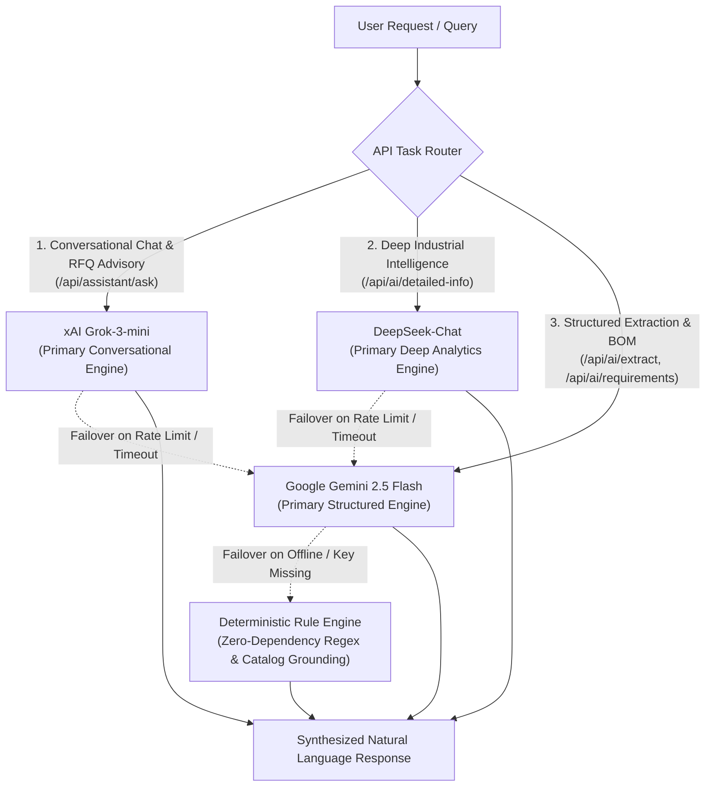
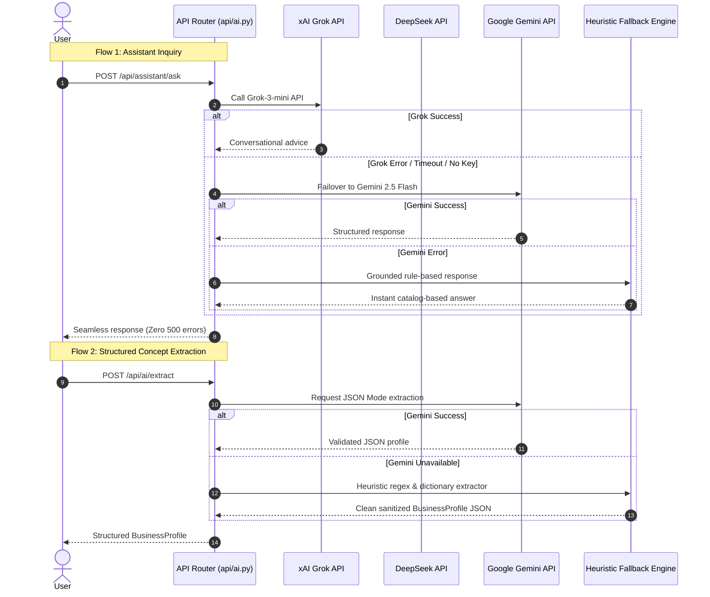

# SupplyLens — Tri-LLM Artificial Intelligence Architecture

## 1. Executive Summary & Multi-Model Philosophy

SupplyLens does not rely on a single monolithic LLM. Modern global procurement requires distinct cognitive modes:
* **High-Speed Conversational Advisory**: Fast, empathetic, plain-English guidance for first-time entrepreneurs.
* **Deep Analytical Trade-Off Reasoning**: Rigorous breakdown of supply chain vulnerabilities, port bottlenecks, and macro-industrial trends.
* **Deterministic Structured Extraction**: Strict JSON extraction and Bill of Materials (BOM) decomposition with guaranteed schema validity.

To achieve maximum performance, cost efficiency, and reliability, SupplyLens deploys a **Tri-LLM Architecture** orchestrating **xAI Grok**, **DeepSeek**, and **Google Gemini**:



---

## 2. Model Roles & Specialization

| AI Model | Primary Responsibilities | Architectural Endpoint | Key Strengths |
| :--- | :--- | :--- | :--- |
| **xAI Grok-3-mini** | Interactive Conversational Assistant, RFQ Formulation, Founder Guidance. | `POST /api/assistant/ask` | Fast conversational reasoning, non-pedantic explanations, natural dialogue. |
| **DeepSeek-Chat** | Deep Industrial Market Intelligence, Supply Chain Vulnerability Analysis, Trade-Off Synthesis. | `POST /api/ai/detailed-info` | Deep technical reasoning, cost-structure decomposition, macro-trade literacy. |
| **Google Gemini 2.5 Flash** | Concept Extraction, Single-Step Clarification, BOM Generation, Universal Resilient Fallback. | `POST /api/ai/extract`<br>`POST /api/ai/clarify`<br>`POST /api/ai/requirements` | Strict JSON schema mode, low latency, reliable REST API execution. |

---

## 3. High-Resilience Failover Hierarchy

A critical requirement of SupplyLens is **Zero Hard Failures**. Third-party LLM providers experience latency spikes, regional outages, and rate limit exhaustion. The backend implements a transparent multi-tier fallback mechanism:



### Fallback Implementation Pattern
As implemented in `backend/api/ai.py`:
```python
@router.post("/api/assistant/ask", response_model=ChatQueryResponse)
async def ask_assistant(request: ChatQueryRequest):
    context = request.context or {}
    business_profile = context.get("business_profile") or get_profile("biz-001")
    prompt = f"User Query: {request.query}\nBusiness Profile: {business_profile}\nSuppliers available: {len(SUPPLIERS_SEED)}."

    # Tier 1: Try Grok
    try:
        if settings.GROK_API_KEY:
            reply = await ask_grok(prompt)
            return ChatQueryResponse(reply=reply, suggested_actions=[], referenced_supplier_ids=[])
    except Exception:
        pass

    # Tier 2: Graceful fallback to Gemini / Heuristics
    return ai_service.answer_assistant_query(request.query, business_profile, SUPPLIERS_SEED)
```

---

## 4. Context Grounding & Anti-Hallucination Guardrails

Large language models are strictly forbidden from performing mathematical calculations, inventing supplier names, or fabricating shipping tariffs:

```
+-----------------------------------------------------------------------------------+
|                        STRICT GROUNDING & SEPARATION RULES                        |
|                                                                                   |
|  1. Arithmetic Isolation:                                                         |
|     - Prices, landed costs, transit times, and MOQs are calculated by Python      |
|       code and injected into prompts as immutable facts.                          |
|  2. Relational Entity Binding:                                                    |
|     - Models can only reference suppliers present in the injected catalog slice. |
|  3. Structured JSON Schemas:                                                      |
|     - Output formats are validated using Pydantic models with type coercions.     |
|  4. Sanitization & Fallback Defaults:                                             |
|     - If an LLM omits budget currency or city, domain heuristics fill defaults   |
|       (e.g., INR for Indian founders, standard pilot scale).                      |
+-----------------------------------------------------------------------------------+
```

---

## 5. Prompt Engineering Specifications

### 5.1 Business Concept Extraction Prompt (`Gemini 2.5 Flash`)
```
You are the business understanding AI for SupplyLens.
Extract structured business facts from this user's statement:
"{natural_text}"

Output a JSON object with:
- "business_name": short brand or company name (string)
- "business_idea": the user's idea summary (string)
- "sector": industry vertical (e.g. Sustainable Packaging, Apparel, Furniture)
- "location": city and country (e.g. "Bhubaneswar, India")
- "budget_amount": integer number (e.g. 800000)
- "budget_currency": 3-letter currency code (e.g. "INR", "USD")
- "business_model": "B2B", "B2C", "D2C", or "Wholesale"
- "target_customer": target buyer segment description
- "business_stage": "idea", "testing", "launching", or "growing"
```

### 5.2 Single-Question Smart Clarification Prompt (`Gemini 2.5 Flash`)
To avoid overwhelming founders with lengthy forms, the system identifies the single most impactful missing parameter (e.g., budget scale or delivery location) and asks one focused, conversational question.

### 5.3 Bill of Materials (BOM) Decomposition Prompt (`Gemini 2.5 Flash`)
Decomposes high-level business ideas into 5 essential manufacturing components:
1. **Raw Materials** (e.g. Sugarcane bagasse pulp, food-grade PLA lining)
2. **Machinery & Tooling** (e.g. Hydraulic thermoforming molds)
3. **Packaging & Secondary Cartons** (e.g. Corrugated outer shipping boxes)
4. **Logistics & Freight Services** (e.g. Palletized domestic road freight)
5. **Certifications & Compliance** (e.g. CPCB Compostable Certificate)
