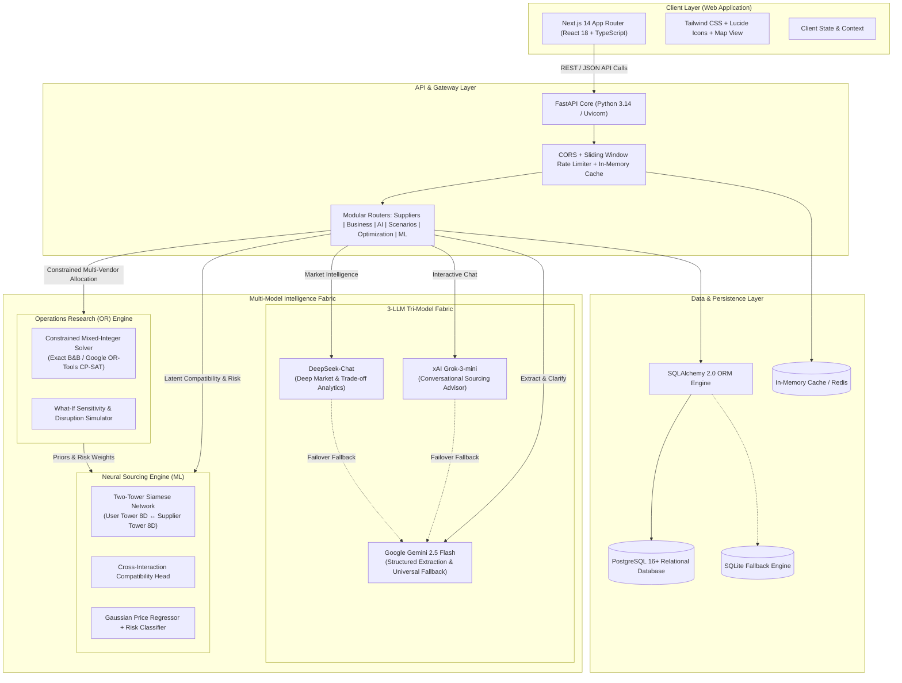
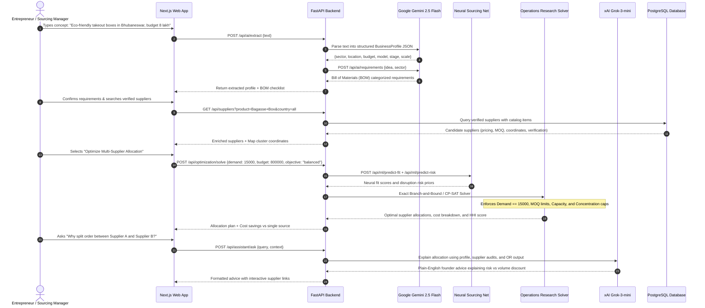

# SupplyLens — System Architecture & Platform Blueprint

## 1. Executive Summary & Vision

**SupplyLens** is an AI-powered global supplier discovery and sourcing intelligence platform engineered specifically for non-technical entrepreneurs, early-stage founders, and enterprise procurement managers.

### 1.1 Core Mission
> *"Tell us what you want to build, and we'll help you figure out what you need and who you should source it from."*

Traditional global procurement platforms suffer from two major flaws:
1. **Unconstrained Generative AI / LLMs**: Large language models hallucinate factory capabilities, invent fictitious pricing, and fail to satisfy hard physical constraints such as factory Minimum Order Quantities (MOQ), monthly line capacity, working capital ceilings, and import tariff barriers.
2. **Static B2B Directory Portals**: Legacy directories rely on brittle keyword lookups, paid advertising priority, or simple distance sorting, completely ignoring founder stage, cash runway, risk tolerance, and multi-supplier portfolio optimization.

SupplyLens resolves this dichotomy by establishing a deterministic, multi-tiered architecture that synthesizes **PostgreSQL relational ground truth**, **neural latent compatibility matching**, **Operations Research (OR) mathematical optimization**, and a **Tri-LLM generative reasoning fabric** (xAI Grok, DeepSeek, and Google Gemini).

---

## 2. High-Level System Architecture



---

## 3. The Four-Tier Separation of Concerns

To guarantee mathematical truth, zero pricing hallucinations, and founder-level transparency, SupplyLens divides every sourcing decision across four distinct layers:

$$\begin{aligned}
\text{Tier 1: PostgreSQL Relational DB} &\longrightarrow \textbf{Physical Ground Truth} \\
\text{Tier 2: Neural Two-Tower Net} &\longrightarrow \textbf{Latent Compatibility \& Prior Learning} \\
\text{Tier 3: Operations Research (MILP)} &\longrightarrow \textbf{Constrained Mathematical Allocation} \\
\text{Tier 4: 3-LLM Multi-Model Fabric} &\longrightarrow \textbf{Natural Language Synthesis \& Advisory}
\end{aligned}$$

```
+-----------------------------------------------------------------------------------+
|                        1. RELATIONAL GROUND TRUTH (POSTGRESQL)                    |
|  - Verified supplier registry with verified tax registrations, factory audits     |
|  - Real catalog items with physical MOQs, capacities, quoted factory price ranges |
|  - Verifiable logistics coordinates, shipping lanes, tariffs, and HS codes        |
+-----------------------------------------------------------------------------------+
                                         |
                                         v
+-----------------------------------------------------------------------------------+
|                     2. NEURAL LATENT COMPATIBILITY (DUAL-TOWER)                   |
|  - Founder Feature Vector (8D) x Supplier Feature Vector (8D)                     |
|  - Computes non-linear alignment: budget elasticity, stage fit, quality appetite  |
|  - Outputs: Fit Compatibility Score (0-1), Price Range (mu +/- 1.96 sigma), Risk  |
+-----------------------------------------------------------------------------------+
                                         |
                                         v
+-----------------------------------------------------------------------------------+
|                 3. OPERATIONS RESEARCH CONSTRAINED OPTIMIZER (MILP)               |
|  - Solves exact multi-supplier split under strict physical business boundaries    |
|  - Hard constraints: 100% Demand Satisfaction, MOQ coupling, Capacity, Budget    |
|  - Objective: Min Normalized Cost + Risk + Lead Time + HHI Concentration Penalty  |
+-----------------------------------------------------------------------------------+
                                         |
                                         v
+-----------------------------------------------------------------------------------+
|                        4. TRI-LLM GENERATIVE INTELLIGENCE                         |
|  - Grok-3-mini: Real-time conversational advisory and procurement reasoning      |
|  - DeepSeek-Chat: Complex market analysis, risk breakdowns, and macro context     |
|  - Gemini 2.5 Flash: Structured extraction, single-question clarification, BOM   |
+-----------------------------------------------------------------------------------+
```

---

## 4. End-to-End Sourcing Lifecycle Data Flow

The following sequence diagram outlines the progression from an entrepreneur's initial concept to an optimized, verified supplier contract:



---

## 5. Technology Stack & Component Taxonomy

| Architectural Layer | Technology | Version | Key Responsibility |
| :--- | :--- | :--- | :--- |
| **Frontend Framework** | Next.js (App Router) | 14.x | Server and client React rendering, responsive layout, dynamic forms. |
| **User Interface** | React + Tailwind CSS | 18.x / 3.4 | Obsidian dark & Ice Zinc themes, data cards, comparison grids. |
| **Geospatial Mapping** | Leaflet / OpenStreetMap | 1.9 | Interactive manufacturing hub maps, location clustering, marker popups. |
| **Backend Framework** | FastAPI (ASGI) | 0.115+ | High-throughput asynchronous REST API, OpenAPI docs, Pydantic validation. |
| **Language Runtime** | Python | 3.14 / 3.11+ | Type-annotated, modern Python architecture. |
| **ORM & Relational DB** | SQLAlchemy 2.0 / PostgreSQL | 2.0 / 16+ | Strict relational schemas, foreign keys, transaction sessions, connection pools. |
| **Conversational LLM** | xAI Grok (grok-3-mini) | API v1 | Founder procurement assistant, real-time Q&A, actionable advice. |
| **Analytical LLM** | DeepSeek (deepseek-chat) | API v1 | Deep supply chain reasoning, detailed market intelligence reports. |
| **Extraction & Fallback**| Google Gemini 2.5 Flash | REST / GenAI | Zero-shot JSON extraction, single-step clarification, BOM decomposition. |
| **Neural Sourcing Engine**| Pure Vectorized Python | In-house | Two-Tower Siamese net, multi-task pricing regression, operational risk model. |
| **Operations Research** | Exact B&B / Google OR-Tools | In-house / 9.x | Mixed-Integer Linear Programming (MILP) & Convex MIQP order allocation. |
| **Logistics Engine** | Landed Cost Calculator | In-house | Haversine distance, multimodal shipping tariffs, port handling, customs duties. |

---

## 6. Non-Functional Architecture & System Attributes

### 6.1 Performance & Latency SLAs
* **Relational Queries & Filtering**: Sub-15ms execution via indexed PostgreSQL foreign keys and compound location indices.
* **Neural ML Inference**: Under 5ms on standard CPU utilizing pure vectorized NumPy/Python arrays (no heavy GPU required).
* **Mathematical Optimization**: Under 25ms runtime for standard supplier catalogs ($N \le 20, K \le 3$) using exact branch-and-bound pruning.
* **Tri-LLM Response Times**: Grok-3-mini and Gemini 2.5 Flash target $<1.8\text{s}$ response times with streaming support.

### 6.2 High-Availability & Resilience
* **Multi-LLM Failover Hierarchy**: If Grok or DeepSeek encounter rate limits or network degradation, requests automatically fall back to Gemini 2.5 Flash, and ultimately to deterministic regex/heuristic fallback engines.
* **Database Resiliency**: The database engine automatically connects to PostgreSQL in production environments while gracefully falling back to a local SQLite database for isolated local testing.
* **Zero-Hallucination Policy**: Generative models are strictly prohibited from calculating numbers, landed costs, or allocation quotas. All arithmetic is computed by the deterministic OR and Logistics engines.

### 6.3 Security & Secrets Management
* Centralized environment variable parsing via `pydantic-settings`.
* API keys (`GEMINI_API_KEY`, `GROK_API_KEY`, `DEEPSEEK_API_KEY`) are kept exclusively on the backend and never exposed to the client.
* In-memory sliding-window rate limiting prevents API abuse and denial-of-service vectors on computationally heavy endpoints.
