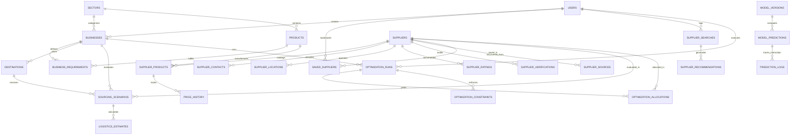

# SupplyLens — Database Architecture & Schema Specification

## 1. Overview & Relational Philosophy

SupplyLens relies on **PostgreSQL 16+** as its immutable relational ground truth, mapped via **SQLAlchemy 2.0** declarative models. 

### Key Principles
* **Relational Integrity**: Strict foreign key constraints and cascade rules prevent orphaned supplier records, unlinked BOM requirements, or dangling logistics scenarios.
* **Separation of Physical Truth from AI**: Relational tables hold audited factory capabilities, real physical MOQs, and verified location coordinates. Generative LLMs and ML networks only read from or append auditable logs to this layer.
* **Resilient Dual-Engine Support**: The engine (`core/database.py`) automatically binds to PostgreSQL in production environments (`DATABASE_URL`), gracefully falling back to a local SQLite database (`supplylens_dev.db`) during isolated local development or CI/CD test runs.

---

## 2. Entity-Relationship Diagram (Mermaid)



---

## 3. Comprehensive Data Dictionary

### 3.1 User & Business Workspace Domain

#### `users`
Represents platform founders, sourcing managers, and internal auditors.
| Column | Type | Constraints | Default | Description |
| :--- | :--- | :--- | :--- | :--- |
| `id` | VARCHAR(36) | PRIMARY KEY | UUID | Unique user identifier. |
| `email` | VARCHAR(255) | UNIQUE, NOT NULL, INDEX | - | User login email. |
| `full_name` | VARCHAR(255) | NOT NULL | - | Full name. |
| `role` | VARCHAR(50) | NOT NULL | "entrepreneur" | `entrepreneur`, `admin`, `auditor`. |
| `created_at` | TIMESTAMP | NOT NULL | UTC Now | Account creation timestamp. |
| `updated_at` | TIMESTAMP | NOT NULL | UTC Now | Last profile update. |

#### `sectors`
Broad industry verticals (Sustainable Packaging, Apparel, Furniture, Electronics, Food Processing).
| Column | Type | Constraints | Default | Description |
| :--- | :--- | :--- | :--- | :--- |
| `id` | VARCHAR(36) | PRIMARY KEY | UUID | Unique sector identifier. |
| `name` | VARCHAR(100) | UNIQUE, NOT NULL | - | Display name of vertical. |
| `slug` | VARCHAR(100) | UNIQUE, NOT NULL | - | URL-safe slug. |
| `description` | TEXT | NULLABLE | - | Industry overview. |
| `icon_name` | VARCHAR(50) | NULLABLE | - | Lucide icon token. |

#### `businesses`
Entrepreneur business workspaces and active sourcing projects.
| Column | Type | Constraints | Default | Description |
| :--- | :--- | :--- | :--- | :--- |
| `id` | VARCHAR(36) | PRIMARY KEY | UUID | Unique business workspace identifier. |
| `user_id` | VARCHAR(36) | FOREIGN KEY (`users.id`) | NULL | Creator user account. |
| `sector_id` | VARCHAR(36) | FOREIGN KEY (`sectors.id`) | NULL | Industry sector. |
| `name` | VARCHAR(255) | NOT NULL | - | Business or brand name. |
| `idea_description`| TEXT | NOT NULL | - | Founder concept description. |
| `target_market` | VARCHAR(255) | NOT NULL | - | Target geography or customer segment. |
| `location` | VARCHAR(255) | NOT NULL | - | Operating headquarters (e.g. Bhubaneswar). |
| `budget_amount` | FLOAT | NOT NULL | - | Available working capital. |
| `budget_currency`| VARCHAR(10) | NOT NULL | "INR" | Currency denomination. |
| `business_model`| VARCHAR(50) | NOT NULL | "contract_oem" | `manufacture`, `contract_oem`, `buy_resell`. |
| `expected_scale` | VARCHAR(50) | NOT NULL | "pilot" | `pilot`, `growth`, `scaled`. |
| `readiness_data` | JSON | NULLABLE | - | 5-dimension readiness assessment snapshot. |

#### `products`
Standardized global catalog of goods and raw materials with HS codes.
| Column | Type | Constraints | Default | Description |
| :--- | :--- | :--- | :--- | :--- |
| `id` | VARCHAR(36) | PRIMARY KEY | UUID | Unique catalog product ID. |
| `sector_id` | VARCHAR(36) | FOREIGN KEY (`sectors.id`) | - | Categorizing sector. |
| `name` | VARCHAR(255) | NOT NULL, INDEX | - | Standard product name. |
| `category` | VARCHAR(100) | NOT NULL | - | Category (Raw Material, Machinery, Packaging).|
| `standard_unit` | VARCHAR(50) | NOT NULL | "pieces" | Unit of measurement. |
| `hs_code` | VARCHAR(20) | NULLABLE | - | Harmonized Tariff System code. |

#### `business_requirements`
Dynamic Bill of Materials (BOM) items required for a business concept.
| Column | Type | Constraints | Default | Description |
| :--- | :--- | :--- | :--- | :--- |
| `id` | VARCHAR(36) | PRIMARY KEY | UUID | Requirement ID. |
| `business_id` | VARCHAR(36) | FOREIGN KEY (`businesses.id`) | - | Parent business. |
| `product_id` | VARCHAR(36) | FOREIGN KEY (`products.id`) | NULL | Mapped catalog product. |
| `name` | VARCHAR(255) | NOT NULL | - | Item description. |
| `category` | VARCHAR(100) | NOT NULL | - | BOM category. |
| `estimated_qty` | FLOAT | NOT NULL | - | Required volume. |
| `priority` | VARCHAR(50) | NOT NULL | "essential" | `essential`, `recommended`, `optional`. |

---

### 3.2 Verified Supplier Registry Domain

#### `suppliers`
The core registry of verified manufacturing facilities, factories, and distributors.
| Column | Type | Constraints | Default | Description |
| :--- | :--- | :--- | :--- | :--- |
| `id` | VARCHAR(36) | PRIMARY KEY | UUID | Unique supplier identifier. |
| `legal_name` | VARCHAR(255) | NOT NULL | - | Official registered company name. |
| `display_name` | VARCHAR(255) | NOT NULL, INDEX | - | Public trade name. |
| `supplier_type` | VARCHAR(50) | NOT NULL, INDEX | "OEM" | `OEM`, `Contract Manufacturer`, `Distributor`.|
| `country` | VARCHAR(100) | NOT NULL, INDEX | - | Manufacturing country. |
| `country_code` | VARCHAR(5) | NOT NULL, INDEX | - | ISO 2-letter country code. |
| `city` | VARCHAR(100) | NOT NULL, INDEX | - | Manufacturing city. |
| `latitude` | FLOAT | NOT NULL, INDEX | - | Geographic latitude coordinate. |
| `longitude` | FLOAT | NOT NULL, INDEX | - | Geographic longitude coordinate. |
| `verification_status`| VARCHAR(50)| NOT NULL, INDEX | "Verified" | `Verified`, `Partially verified`, `Unverified`. |
| `verification_score` | INTEGER | NOT NULL | 90 | Trust score (0 to 100). |
| `data_confidence` | INTEGER | NOT NULL | 92 | Completeness score (0 to 100%). |
| `is_reference_data` | BOOLEAN | NOT NULL | TRUE | Demarcates prototype records from live registries.|

#### `supplier_products`
Specific products, specifications, MOQs, and prices quoted by a supplier.
| Column | Type | Constraints | Default | Description |
| :--- | :--- | :--- | :--- | :--- |
| `id` | VARCHAR(36) | PRIMARY KEY | UUID | Mapping identifier. |
| `supplier_id` | VARCHAR(36) | FOREIGN KEY (`suppliers.id`) | - | Quoting supplier. |
| `product_id` | VARCHAR(36) | FOREIGN KEY (`products.id`) | NULL | Linked standard catalog item. |
| `product_name` | VARCHAR(255) | NOT NULL, INDEX | - | Specific quoted product name. |
| `minimum_order_quantity`| INTEGER | NOT NULL | 1000 | Factory Minimum Order Quantity (MOQ). |
| `maximum_capacity` | INTEGER | NULLABLE | - | Maximum monthly unit capacity. |
| `price_min` | FLOAT | NOT NULL, INDEX | - | Minimum quoted unit price (INR). |
| `price_max` | FLOAT | NOT NULL | - | Maximum quoted unit price (INR). |
| `price_type` | VARCHAR(50) | NOT NULL | "quoted" | `quoted`, `publicly_listed`, `estimated`. |

#### `supplier_verifications`
Official physical onsite audit reports, trade licenses, and certificates.
| Column | Type | Constraints | Default | Description |
| :--- | :--- | :--- | :--- | :--- |
| `id` | VARCHAR(36) | PRIMARY KEY | UUID | Verification record ID. |
| `supplier_id` | VARCHAR(36) | FOREIGN KEY (`suppliers.id`) | - | Audited supplier. |
| `verification_type`| VARCHAR(100)| NOT NULL | - | `Physical Onsite`, `Registry Match`, `ISO Audit`.|
| `status` | VARCHAR(50) | NOT NULL | "Verified" | `Verified`, `Partially verified`. |
| `evidence` | JSON | NOT NULL | - | Structured checklist items and certificate proof.|

---

### 3.3 Logistics & Sourcing Scenarios Domain

#### `destinations`
User delivery endpoints (factory floors, central warehouses, retail outlets).
| Column | Type | Constraints | Default | Description |
| :--- | :--- | :--- | :--- | :--- |
| `id` | VARCHAR(36) | PRIMARY KEY | UUID | Destination identifier. |
| `business_id` | VARCHAR(36) | FOREIGN KEY (`businesses.id`) | - | Owning business. |
| `name` | VARCHAR(255) | NOT NULL | - | Destination name (e.g. "Bhubaneswar Hub").|
| `latitude` | FLOAT | NOT NULL | 20.2961 | Latitude coordinate. |
| `longitude` | FLOAT | NOT NULL | 85.8245 | Longitude coordinate. |
| `destination_type`| VARCHAR(50) | NOT NULL | "Business" | `Business`, `Warehouse`, `Port`. |

#### `sourcing_scenarios` & `logistics_estimates`
Evaluated sourcing combinations connecting supplier origins to buyer destinations.
* Tracks `supplier_unit_price`, `estimated_product_cost`, `estimated_logistics_cost`, `estimated_total_cost`, and calculated `estimated_cost_per_unit`.
* `logistics_estimates` records transit mode (`road`, `sea`, `air`), distance in km, transit days, and itemized freight tariffs.

---

### 3.4 Operations Research & Optimization Domain

#### `optimization_runs`
Audit trail of every mathematical multi-supplier allocation run.
| Column | Type | Constraints | Default | Description |
| :--- | :--- | :--- | :--- | :--- |
| `id` | VARCHAR(36) | PRIMARY KEY | UUID | Unique run ID. |
| `user_id` | VARCHAR(36) | FOREIGN KEY (`users.id`) | NULL | Requesting user. |
| `business_id` | VARCHAR(36) | FOREIGN KEY (`businesses.id`) | NULL | Associated business workspace. |
| `objective_type`| VARCHAR(50) | NOT NULL | "balanced" | `min_cost`, `balanced`, `diversified`, `min_risk`.|
| `solver` | VARCHAR(50) | NOT NULL | "Exact-B&B" | `Exact-B&B`, `OR-Tools CP-SAT`, `SCIP`. |
| `status` | VARCHAR(50) | NOT NULL | "OPTIMAL" | `OPTIMAL`, `FEASIBLE`, `INFEASIBLE`, `TIMEOUT`.|
| `required_quantity`| FLOAT | NOT NULL | - | Customer required demand $D$. |
| `available_budget`| FLOAT | NOT NULL | - | Maximum spend ceiling $B$. |
| `total_cost` | FLOAT | NOT NULL | - | Total procurement cost. |
| `runtime_ms` | FLOAT | NOT NULL | - | Solver compute time in milliseconds. |

#### `optimization_allocations`
Exact allocated quantity ($x_i$) and share percentage for each active supplier.
| Column | Type | Constraints | Default | Description |
| :--- | :--- | :--- | :--- | :--- |
| `id` | VARCHAR(36) | PRIMARY KEY | UUID | Allocation record ID. |
| `optimization_run_id`| VARCHAR(36)| FOREIGN KEY (`optimization_runs.id`)| - | Parent run. |
| `supplier_id` | VARCHAR(36) | FOREIGN KEY (`suppliers.id`) | - | Selected vendor. |
| `quantity` | FLOAT | NOT NULL | - | Allocated units ($x_i$). |
| `unit_price` | FLOAT | NOT NULL | - | Landed unit price ($c_i$). |
| `percentage_of_total`| FLOAT | NOT NULL | - | $x_i / D \times 100\%$. |

---

### 3.5 Machine Learning & Telemetry Domain

#### `model_versions`
Registry of neural network checkpoints and hyperparameters.
| Column | Type | Constraints | Default | Description |
| :--- | :--- | :--- | :--- | :--- |
| `id` | VARCHAR(64) | PRIMARY KEY | String | Model tag (e.g. `TwoTower-v1.0.0`). |
| `architecture_type`| VARCHAR(100)| NOT NULL | - | `TwoTower-MLP`, `Gaussian-Regressor`. |
| `hyperparameters`| JSON | NOT NULL | `{}` | Layer dimensions, learning rate, activations. |
| `metrics_snapshot`| JSON | NOT NULL | `{}` | Benchmark ROC-AUC, MAE, validation loss. |
| `is_active` | BOOLEAN | NOT NULL | TRUE | Active inference status. |

#### `model_predictions` & `prediction_logs`
Audit record of live inference predictions generated by neural models and subsequent user actions (`viewed`, `saved`, `compared`, `contacted`, `contracted`) for closed-loop continuous learning.

---

## 4. Indexing & Performance Strategy

```sql
-- Fast Geospatial Coordinate Lookups
CREATE INDEX idx_suppliers_lat_lng ON suppliers(latitude, longitude);

-- Fast Faceted Filtering
CREATE INDEX idx_suppliers_filter ON suppliers(country_code, supplier_type, verification_status);

-- Price Range Indexing
CREATE INDEX idx_supplier_products_price ON supplier_products(price_min, minimum_order_quantity);

-- Optimization & Scenario Queries
CREATE INDEX idx_allocations_run ON optimization_allocations(optimization_run_id);
CREATE INDEX idx_scenarios_dest ON sourcing_scenarios(destination_location_id);
```

---

## 5. Schema Migrations & Initialization

1. **Initial Migration**: `database/migrations/001_initial_schema.sql` establishes all tables, primary keys, foreign keys, and indexes.
2. **Seed Data**: `database/seeds/seed_reference_data.sql` provisions initial verified suppliers, locations, and pricing benchmarks across Odisha, Gujarat, Tamil Nadu, and Vietnam.
3. **Automated Initialization**: The backend calls `init_db()` during startup lifespan, ensuring tables are verified without manual intervention.
