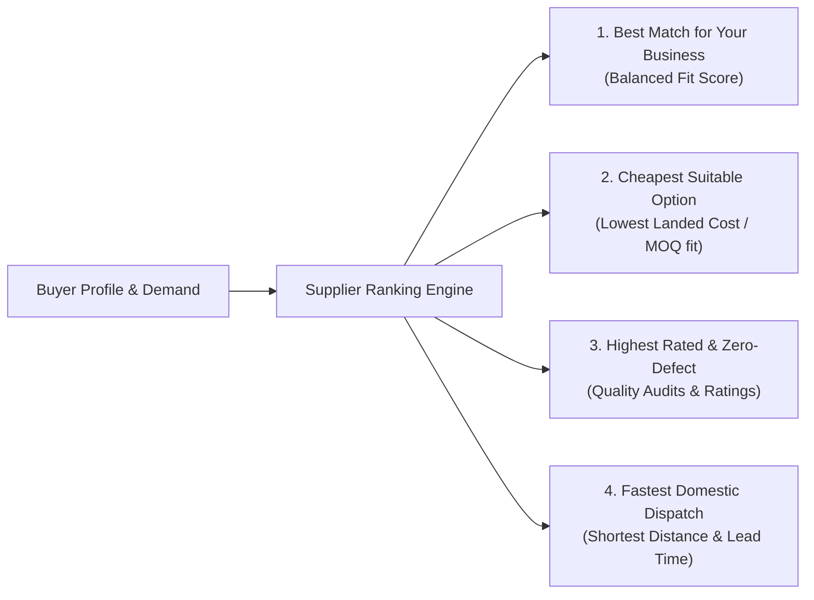

# SupplyLens — Supplier Ingestion, Verification & Discovery Pipeline

## 1. Overview & Pipeline Philosophy

The SupplyLens Supplier Pipeline is designed to eliminate the risks of B2B procurement fraud, ghost factories, and phantom pricing. 

In traditional sourcing directories, up to 40% of listed entities are unverified intermediaries, brokers, or shell entities claiming direct factory prices. SupplyLens implements a strict **4-Tier Verification Protocol**, an automated **Landed Cost Engine**, and **Multi-Lens Discovery Heuristics** to ensure that entrepreneurs only engage with legitimate, audit-backed manufacturing facilities.

```mermaid
flowchart TD
    subgraph Ingestion ["1. Data Ingestion & Harvesting"]
        Registries["Trade Registries (MCA / GST / Customs)"]
        DirectAudit["Physical Audit Logs & Inspection Reports"]
        DemoFeeds["Benchmark Demo Catalog Feeds"]
    end

    subgraph Verification ["2. 4-Tier Verification Engine"]
        Tier1["Tier 1: Corporate Legal Identity (GST / CIN)"]
        Tier2["Tier 2: Physical Geospatial Audit (Coordinates & Satellite)"]
        Tier3["Tier 3: Manufacturing Line Capacity & Certifications"]
        Tier4["Tier 4: Active Channel & Inquiry Desk Verification"]
    end

    subgraph LogisticsEngine ["3. Geospatial & Landed Cost Engine"]
        GeoDistance["Haversine Road & Sea Distance Matrix"]
        TransitEngine["Multimodal Routing (Road / Ocean / Air)"]
        LandedCost["Landed Cost Engine (Ex-Factory + Freight + Tariffs + Insurance)"]
    end

    subgraph Discovery ["4. Discovery & Multi-Lens Recommendation"]
        FacetFilter["Faceted Search & Natural Language Parser"]
        Lens1["Lens 1: Best Match for Your Business"]
        Lens2["Lens 2: Cheapest Suitable Option"]
        Lens3["Lens 3: Highest Rated & Zero-Defect"]
        Lens4["Lens 4: Fastest Domestic Dispatch"]
    end

    Ingestion --> Verification
    Verification -->|Audited Records & Trust Scores| LogisticsEngine
    LogisticsEngine --> Discovery
    Discovery -->|Ranked Verified Results| SourcingManager["Entrepreneur / Sourcing Manager"]
```



---

## 2. The 4-Tier Verification Framework

Every supplier entity in the SupplyLens registry undergoes a rigorous 4-step auditing evaluation before achieving `Verified` status:

### Tier 1: Corporate Legal Identity
* **Validation**: Checks against official government registries (Ministry of Corporate Affairs, GST portal in India, General Administration of Customs in China, National Business Registration Portal in Vietnam).
* **Checks**: Valid Tax Identification Number, active business operational status, absence of bankruptcy proceedings.
* **Failure Condition**: Immediate rejection or assignment of `Unverified` status if legal entity records are inactive or mismatched.

### Tier 2: Physical Geospatial Verification
* **Validation**: Verifies physical facility location using high-resolution satellite imagery, postal verification, and geographic coordinate mapping.
* **Checks**: Confirms the location is situated in an approved industrial manufacturing zone or export processing zone, rather than a residential address or virtual office.
* **Classification**: Distinguishes authentic **Original Equipment Manufacturers (OEM)** and **Contract Manufacturers** from commercial trading brokers.

### Tier 3: Manufacturing Capacity & Technical Audit
* **Validation**: Audits active production machinery, daily plant throughput, and international quality certifications.
* **Checks**:
  * ISO 9001 (Quality Management System)
  * ISO 14001 (Environmental Standards)
  * Food-contact / CE / FDA compliance where applicable
  * Verification of Minimum Order Quantity (MOQ) and maximum monthly capacity to prevent phantom quoting.

### Tier 4: Active Channel & Inquiry Desk Verification
* **Validation**: Direct communication verification via verified business phone, email, and inquiry desk response latency.
* **Checks**: Verifies direct responsiveness to requests for quotation (RFQ) and ensures contact numbers belong to verified commercial sales desks rather than unauthorized brokers.

---

## 3. Trust Scoring & Data Confidence Formulation

SupplyLens assigns two transparent metrics to every supplier record:

### 3.1 Verification Score ($V \in [0, 100]$)
The Verification Score reflects the audit rigor and institutional trust of the facility:

$$V = 0.35 \cdot S_{\text{legal}} + 0.25 \cdot S_{\text{geo}} + 0.25 \cdot S_{\text{audit}} + 0.15 \cdot S_{\text{contact}}$$

Where:
* $S_{\text{legal}} = 100$ if registered tax ID and active corporate charter are verified; $0$ otherwise.
* $S_{\text{geo}} = 100$ if coordinates match verified manufacturing zone; $50$ if commercial office; $0$ if unverified.
* $S_{\text{audit}} = 100$ if physical onsite inspection conducted; $80$ if third-party certified (ISO); $40$ if self-reported.
* $S_{\text{contact}} = 100$ if business inquiry desk phone/email verified within 90 days.

### 3.2 Data Confidence Rating ($C \in [0, 100\%]$)
Measures the completeness and freshness of catalog parameters:
$$C = \frac{\sum_{k=1}^M w_k \cdot \mathbb{I}(\text{field}_k \text{ is verified and fresh})}{\sum_{k=1}^M w_k} \times 100\%$$

Fields evaluated include verified price ranges, MOQs, capacity limits, lead times, and updated audit timestamps.

---

## 4. Geospatial Intelligence & Multimodal Logistics

### 4.1 Great-Circle & Actual Transit Distance
Transit distance between supplier coordinates $(\phi_s, \lambda_s)$ and destination coordinates $(\phi_d, \lambda_d)$ is calculated using the Haversine formula:

$$\Delta\sigma = 2 \arcsin \left( \sqrt{\sin^2\left(\frac{\Delta\phi}{2}\right) + \cos(\phi_s)\cos(\phi_d)\sin^2\left(\frac{\Delta\lambda}{2}\right)} \right)$$
$$d = R \cdot \Delta\sigma \quad (R = 6,371\text{ km})$$

To account for actual road and shipping lane topography:
* **Domestic Road Multiplier**: $d_{\text{road}} = 1.25 \cdot d$
* **Ocean Shipping Multiplier**: $d_{\text{ocean}} = 1.35 \cdot d$

### 4.2 Transparent Landed Cost Engine
Unlike portals that only show ex-factory quotes, SupplyLens calculates the complete **Estimated Landed Cost**:

$$\text{Landed Cost} = \text{Ex-Factory Cost} + \text{Freight} + \text{Customs Tariffs} + \text{Port Handling} + \text{Insurance}$$

```
+-----------------------------------------------------------------------------------+
|                           LANDED COST BREAKDOWN FORMULA                           |
|                                                                                   |
|  1. Ex-Factory Outlay:     P_unit * Quantity                                      |
|  2. Freight Tariff:        Domestic Road (₹12/km/ton) OR Ocean Cargo (₹4/km/ton)  |
|  3. Customs & Tariffs:     Import Duty (5%-15% of CIF) + Local GST (18%)         |
|  4. Port & Handling:       Fixed terminal and clearance fee (₹650 - ₹2,500)      |
|  5. Transit Insurance:     0.5% - 1.0% of declared cargo value                   |
+-----------------------------------------------------------------------------------+
```

---

## 5. Discovery & The 4 Recommendation Lenses

When an entrepreneur searches for suppliers or requests recommendations, SupplyLens computes four tailored lenses:



| Lens Name | Objective Focus | Key Selection Heuristic |
| :--- | :--- | :--- |
| **Best Match for Your Business** | Holistic Strategic Alignment | Highest composite score across MOQ compatibility, budget runway, and verified quality. |
| **Cheapest Suitable Option** | Capital Preservation | Minimizes total estimated landed cost per unit, filtering strictly for suppliers whose MOQ $\le$ buyer budget. |
| **Highest Rated & Zero-Defect**| Product Excellence | Selects verified facilities with highest customer audit rating ($\ge 4.75$) and ISO certification. |
| **Fastest Domestic Dispatch** | Time-to-Market | Minimizes total transit and manufacturing lead time (domestic suppliers within 500km). |

---

## 6. Natural Language Supplier Search

Entrepreneurs can bypass complex filter drop-downs using natural language:
* **Example**: *"I need bio-degradable meal boxes in Odisha or Tamil Nadu under 6 rupees with MOQ less than 5000."*
* **Pipeline Execution**:
  1. `POST /api/suppliers/natural-search` forwards query to the parsing layer.
  2. Extracted JSON:
     ```json
     {
       "product": "bio-degradable meal box",
       "preferred_states": ["Odisha", "Tamil Nadu"],
       "max_price": 6.0,
       "max_moq": 5000,
       "priority": "price"
     }
     ```
  3. Filter criteria are applied against the verified database, returning sorted candidates instantly.
